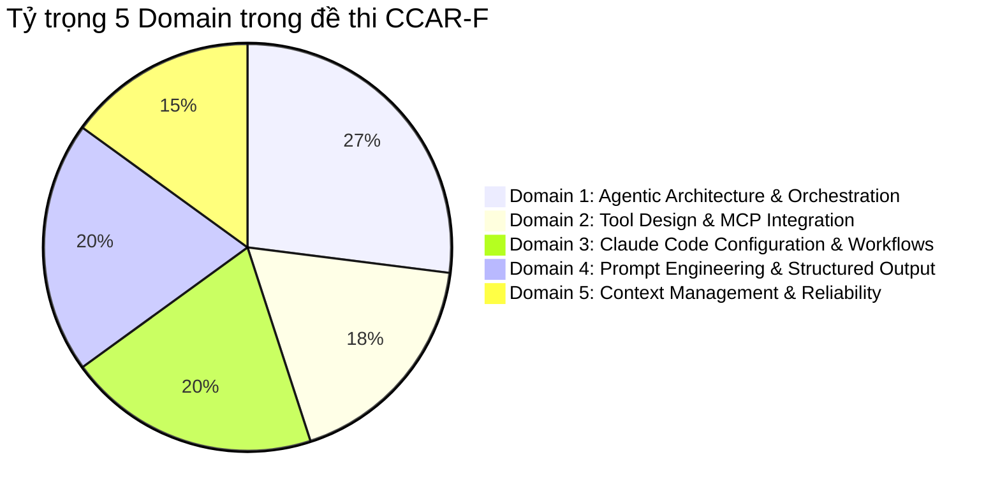
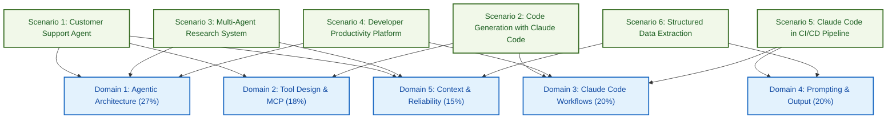

# Tổng quan & Đề cương Kỳ thi CCAR-F

:::info 🎯 Mục tiêu bài viết
Bài viết này cung cấp bức tranh toàn cảnh về chứng chỉ **Claude Certified Architect – Foundations (CCAR-F)** của Anthropic: đối tượng mục tiêu, thông số kỹ thuật kỳ thi, bảng tỷ trọng Blueprint 5 Domain và phân tích chuyên sâu 6 kịch bản thực tế (Exam Scenarios).
:::

---

## 1. Giới thiệu Chứng chỉ & Triết lý Đánh giá

Chứng nhận **Claude Certified Architect – Foundations (Mã kỳ thi: CCAR-F)** là chứng chỉ năng lực kiến trúc chính thức đầu tiên do Anthropic ban hành (Phiên bản 1.0, hiệu lực từ tháng 07/2026). 

Khác với các bài thi trắc nghiệm học vẹt lý thuyết thông thường, CCAR-F được thiết kế theo chuẩn **Criterion-Referenced Assessment** (Đánh giá theo tiêu chuẩn tham chiếu năng lực cố định). Kỳ thi đặt trọng tâm vào việc đánh giá khả năng đưa ra **quyết định đánh đổi kiến trúc (Architectural Trade-offs)** trong các hệ thống AI cấp production:

> *"Trong môi trường production, một Solution Architect giỏi không phải là người chỉ biết viết prompt cho chạy được, mà là người biết khi nào nên dùng code tất định (deterministic enforcement), khi nào nên dùng LLM (probabilistic reasoning), và cách kiểm soát rủi ro về chi phí, ngữ cảnh lẫn độ tin cậy."*

### Đối tượng Mục tiêu
- **Solution Architects & Tech Leads:** Thiết kế kiến trúc giải pháp tích hợp Claude API, Claude Agent SDK và Model Context Protocol (MCP).
- **Backend / AI Engineers (Junior & Mid):** Lập trình các hệ thống Multi-Agent, xây dựng MCP Tool servers, kiểm soát schema dữ liệu.
- **Fresher & Sinh viên CNTT:** Xây dựng tư duy kiến trúc bài bản, làm quen với Agentic AI và công cụ kỹ thuật phần mềm hiện đại như Claude Code.

---

## 2. Thông số Kỳ thi Tóm tắt (Exam at a Glance)

| Tiêu chí | Chi tiết kỹ thuật | Ghi chú sư phạm |
| :--- | :--- | :--- |
| **Mã bài thi** | **CCAR-F** | Claude Certified Architect – Foundations |
| **Số lượng câu hỏi** | **60 câu** | Câu hỏi tình huống (Scenario-based): Multiple-choice & Multiple-response |
| **Thời gian làm bài** | **120 phút** | Trung bình 2 phút cho mỗi câu hỏi tình huống |
| **Cấu trúc đề** | **4 kịch bản ngẫu nhiên** | Rút thăm từ ngân hàng 6 kịch bản production chuẩn |
| **Thang điểm** | **100 – 1.000 điểm** | Điểm chuẩn hóa (Scaled score) |
| **Điểm đạt (Cut Score)** | **720 / 1.000** | Khoảng 72% câu trả lời đúng |
| **Hình thức thi** | Trực tuyến có giám sát / Test Center | Đăng ký qua Anthropic Partner Academy & Pearson VUE |
| **Lệ phí thi** | **125 USD** | Cho mỗi lượt thi |
| **Thời hạn hiệu lực** | **12 tháng** | Cần thi lại hoặc cập nhật sau 1 năm do công nghệ AI phát triển nhanh |

---

## 3. Đề cương Nội dung Kỳ thi (Content Blueprint)

Đề cương kỳ thi được phân bổ thành 5 Content Domains. Tỷ trọng phần trăm phản ánh trực tiếp số lượng câu hỏi xuất hiện trong bài thi:

| Domain | Tên chuyên đề | Tỷ trọng | Trọng tâm đánh giá |
| :---: | :--- | :---: | :--- |
| **01** | **Agentic Architecture & Orchestration** | **27%** | Vòng lặp Agentic loop, điều phối Coordinator–Subagent, session resumption, hooks chặn tool call. |
| **02** | **Tool Design & MCP Integration** | **18%** | Thiết kế tool description phân định ranh giới, cấu trúc phản hồi lỗi MCP, chính sách cấp quyền tool. |
| **03** | **Claude Code Configuration & Workflows** | **20%** | Phân tầng cấu hình `CLAUDE.md`, scoped rules `.claude/rules/`, Plan Mode, tự động hóa CI/CD. |
| **04** | **Prompt Engineering & Structured Output** | **20%** | Ép schema JSON qua tool use, validation-retry loop, Message Batches API, Multi-pass code review. |
| **05** | **Context Management & Reliability** | **15%** | Quản lý Context Window đa lượt, bảo toàn nguồn gốc (provenance), xử lý timeout và phân cấp leo thang. |
| **Tổng** | **5 Chuyên đề cốt lõi** | **100%** | **60 câu hỏi tình huống chuyên sâu** |

---

## 4. Bản đồ Ánh xạ 6 Kịch bản Thực tế (Exam Scenarios Mapping)

Đề thi sẽ chọn ngẫu nhiên **4 trong số 6 kịch bản** thực tế dưới đây. Mỗi kịch bản là một bối cảnh production thực chiến, đan xen kiến thức của nhiều Domain:

---

## 5. Giải phẫu Chi tiết 6 Kịch bản Production (Scenario Deep-Dive)

### Kịch bản 1: Customer Support Resolution Agent
- **Bối cảnh:** Xây dựng hệ thống Agent chăm sóc khách hàng tự động giải quyết các yêu cầu đổi trả, tra cứu đơn và hoàn tiền.
- **Thách thức kỹ thuật:**
  - Ngăn ngừa tình trạng Agent tự ý gọi `process_refund` khi chưa xác thực danh tính khách hàng qua `get_customer`.
  - Phân biệt các tool có chức năng gần giống nhau (`get_customer` vs `lookup_order`).
  - Thiết lập cơ chế leo thang (Escalation) rõ ràng: Khi nào tự xử lý, khi nào bắt buộc chuyển nhân viên con người.
- **Bài học cốt lõi:** Các nghiệp vụ liên quan đến tài chính hoặc tính pháp lý phải được bảo vệ bằng **Programmatic Hook / Code tất định**, tuyệt đối không dựa vào câu chữ trong prompt.

### Kịch bản 2: Code Generation với Claude Code
- **Bối cảnh:** Triển khai công cụ Claude Code cho đội ngũ phát triển phần mềm trên một codebase lớn đa công nghệ (React, Node.js API, Prisma ORM).
- **Thách thức kỹ thuật:**
  - Tránh ô nhiễm context khi đưa quá nhiều quy tắc vào một file `CLAUDE.md` duy nhất.
  - Tách các quy ước theo thư mục và đuôi file bằng `.claude/rules/*.md`.
  - Xây dựng slash command và custom skill dùng chung cho toàn bộ thành viên trong kho chứa git.

### Kịch bản 3: Hệ thống Nghiên cứu Đa Agent (Multi-Agent Research)
- **Bối cảnh:** Điều phối nhiều agent nghiên cứu song song: một subagent tìm kiếm web, một subagent phân tích tài liệu PDF nội bộ, và một synthesis agent tổng hợp báo cáo.
- **Thách thức kỹ thuật:**
  - Tránh cơ chế kế thừa context tự động (automatic context inheritance) làm phình to context window.
  - Xử lý khi subagent bị timeout hoặc lỗi mạng: Lan truyền thông tin lỗi có cấu trúc (`failure_type`, `partial_results`) để coordinator không bị crash.
  - Bảo toàn nguồn gốc thông tin (Information Provenance): Ghi chú rõ nguồn URL, đoạn trích dẫn và thời gian thu thập dữ liệu; giữ nguyên số liệu mâu thuẫn giữa hai nguồn uy tín thay vì tự ý chọn bừa một bên.

### Kịch bản 4: Năng suất Lập trình viên với Claude
- **Bối cảnh:** Sử dụng Claude Code để tái cấu trúc (refactor) một ứng dụng monolithic lớn sang kiến trúc microservices.
- **Thách thức kỹ thuật:**
  - Nhận diện khi nào nên dùng **Plan Mode** (`claude --permission-mode plan`) để khám phá và lập kế hoạch ranh giới module, và khi nào mới chuyển sang thực thi sửa đổi code.
  - Tối ưu chi phí và bộ nhớ với lệnh `/compact` và `/memory`.

### Kịch bản 5: Claude Code cho Continuous Integration (CI/CD)
- **Bối cảnh:** Tích hợp Claude Code vào quy trình GitHub Actions / GitLab CI để tự động review Pull Request lớn và kiểm tra lỗ hổng bảo mật.
- **Thách thức kỹ thuật:**
  - Chạy Claude Code ở chế độ không tương tác (headless mode) với flag `-p` / `--print`.
  - Sử dụng cờ `--bare` để loại bỏ các hook và file cấu hình rác từ máy host, đảm bảo tính nhất quán trên runner CI.
  - Ép kết quả review trả về JSON có cấu trúc qua cờ `--output-format json` và `--json-schema`.
  - Khắc phục hiện tượng **Pha loãng chú ý (Attention Dilution)** trên các PR lớn (14+ file) bằng kiến trúc **Multi-pass Review** (chia thành pass theo từng file kết hợp với pass tích hợp liên file).

### Kịch bản 6: Trích xuất Dữ liệu Có cấu trúc (Structured Data Extraction)
- **Bối cảnh:** Trích xuất thông tin tài chính phức tạp từ hàng ngàn hóa đơn và hợp đồng quét dạng ảnh/PDF.
- **Thách thức kỹ thuật:**
  - Sử dụng cơ chế `tool_use` kết hợp JSON Schema chuẩn (`strict: true`) để đảm bảo dữ liệu đầu ra không bao giờ bị sai cú pháp.
  - Thiết kế vòng lặp Validation-Retry kết hợp bắt lỗi kiểm định ngữ nghĩa (semantic validation).
  - Tối ưu hóa chi phí và lưu lượng bằng **Message Batches API** (tiết kiệm 50% chi phí, chấp nhận độ trễ xử lý trong 24 giờ).

---

## 6. Mẹo Sư phạm & Cạm bẫy Cần tránh khi Thi

:::tip 💡 Mẹo làm bài thi CCAR-F
1. **Ưu tiên Giải pháp Tất định (Deterministic First):** Khi câu hỏi đặt vấn đề về an toàn, tài chính, hoặc bắt buộc thứ tự thực thi (execution order), hãy luôn tìm phương án dùng **Code / Programmatic Hook / Middleware** thay vì phương án tinh chỉnh System Prompt hay Few-shot examples.
2. **Nguyên tắc Phân quyền Tối thiểu (Least Privilege):** Khi cấu hình tools cho subagents, chỉ cấp đúng các tool cần thiết (`allowedTools`). Không bao giờ cấp toàn bộ toolset cho một agent chuyên trách.
3. **Phân biệt Rõ ràng Tool Description:** Khi LLM chọn nhầm tool giữa 2 tool tương tự, bước khắc phục đầu tiên và tiết kiệm nhất là **mở rộng mô tả (Tool Description)** với định dạng input cụ thể, ví dụ truy vấn và ranh giới loại trừ, trước khi nghĩ đến việc viết thêm routing layer phức tạp.
:::

:::caution ⚠️ Cạm bẫy Trắc nghiệm Dễ Mắc phải
- **Bẫy "Tăng Context Window":** Khi model review PR lớn bị sót lỗi hoặc đánh giá hời hợt, phương án "nâng cấp lên model có context window lớn hơn" luôn là **phương án sai**. Nguyên nhân thực sự là do *sự pha loãng độ chú ý (attention dilution)*, giải pháp đúng phải là tái cấu trúc thành *Multi-pass Review*.
- **Bẫy "Lựa chọn Tùy tiện khi Xung đột":** Khi hai nguồn tài liệu uy tín đưa ra hai số liệu thống kê khác nhau, phương án "chọn số liệu từ nguồn uy tín hơn hoặc tính trung bình" là sai. Nguyên tắc của Claude Architect là phải **bảo toàn cả 2 số liệu kèm chú thích nguồn gốc và ngữ cảnh phương pháp luận**.
:::

---

## 7. Tài liệu Tham chiếu Chính thức từ Anthropic

Để chuẩn bị tốt nhất cho kỳ thi, bạn nên đối chiếu trực tiếp với các tài liệu chuẩn từ hệ thống tài liệu của Anthropic:

- **Hệ thống Claude Code CLI & Thư mục cấu hình:**
  - [Khám phá thư mục `.claude`](file:///Users/anhtus/Documents/Development/Documentary/vuanhtu1993.github.io/sources/documentations/code.claude.com/docs/en/claude-directory.md)
  - [Quản lý bộ nhớ và CLAUDE.md](file:///Users/anhtus/Documents/Development/Documentary/vuanhtu1993.github.io/sources/documentations/code.claude.com/docs/en/memory.md)
  - [Chạy Claude Code trong môi trường Headless CI/CD](file:///Users/anhtus/Documents/Development/Documentary/vuanhtu1993.github.io/sources/documentations/code.claude.com/docs/en/headless.md)
  - [Các chế độ cấp quyền (Permission Modes)](file:///Users/anhtus/Documents/Development/Documentary/vuanhtu1993.github.io/sources/documentations/code.claude.com/docs/en/permission-modes.md)
- **Hệ thống Claude Platform & API:**
  - [Điều phối Đa Agent (Multiagent Orchestration)](file:///Users/anhtus/Documents/Development/Documentary/vuanhtu1993.github.io/sources/documentations/platform.claude.com/docs/en/managed-agents/multiagent-orchestration.md)
  - [Xử lý Stop Reasons trong Agentic Loop](file:///Users/anhtus/Documents/Development/Documentary/vuanhtu1993.github.io/sources/documentations/platform.claude.com/docs/en/build-with-claude/handling-stop-reasons.md)
  - [Xuất Dữ liệu Cấu trúc với JSON Schema](file:///Users/anhtus/Documents/Development/Documentary/vuanhtu1993.github.io/sources/documentations/platform.claude.com/docs/en/build-with-claude/structured-outputs.md)
  - [Xử lý Bất đồng bộ với Message Batches API](file:///Users/anhtus/Documents/Development/Documentary/vuanhtu1993.github.io/sources/documentations/platform.claude.com/docs/en/build-with-claude/batch-processing.md)
  - [Cơ chế Trích dẫn Nguồn gốc (Citations & Provenance)](file:///Users/anhtus/Documents/Development/Documentary/vuanhtu1993.github.io/sources/documentations/platform.claude.com/docs/en/build-with-claude/citations.md)

---

> *Made by Anh Tu - Share to be share*
