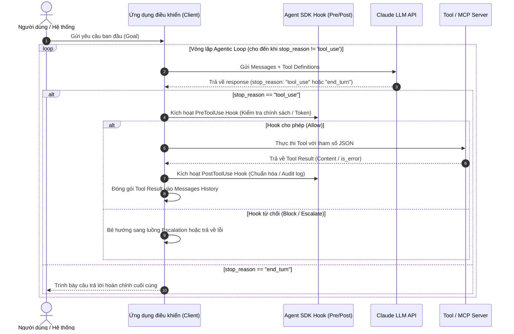
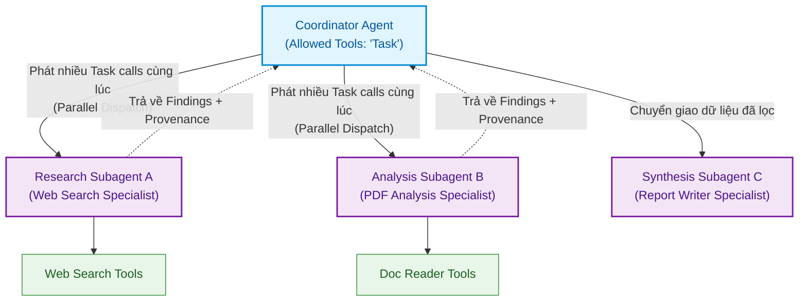
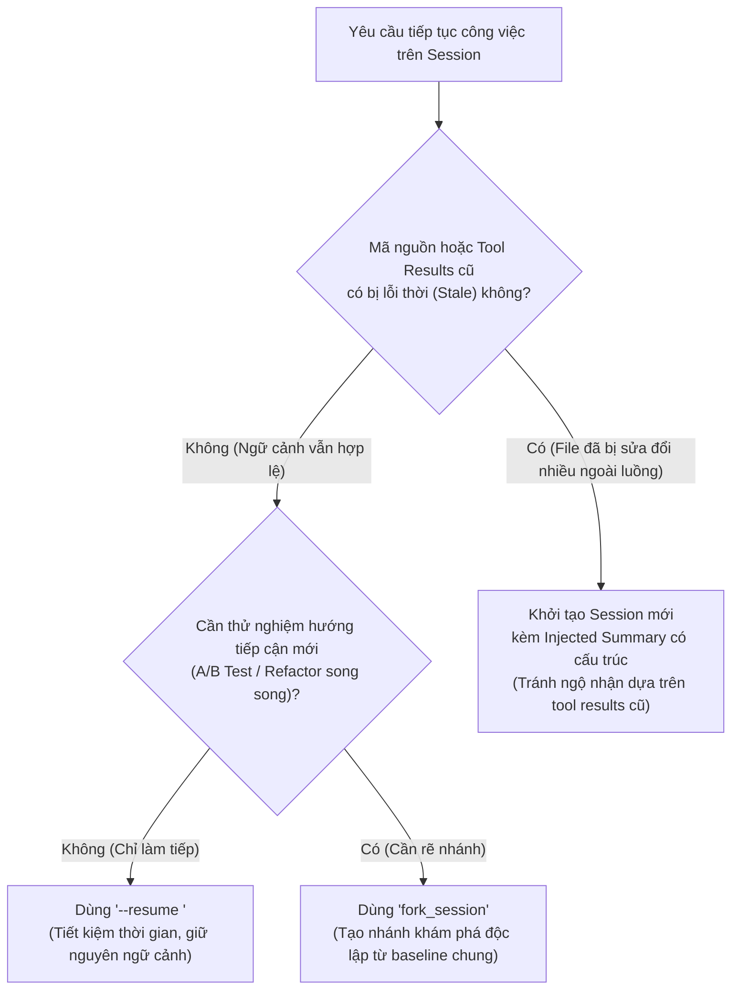

# Domain 1: Kiến trúc Agentic & Điều phối (27%)

:::info 🎯 Mục tiêu Domain 1
Domain 1 chiếm tỷ trọng lớn nhất trong đề thi (**27% trọng số, khoảng 16 câu hỏi**). Domain này đánh giá năng lực làm chủ vòng lặp tác nhân (**Agentic Loop**), kỹ thuật điều phối đa Agent (**Coordinator–Subagent Orchestration**), quản lý phiên làm việc (**Session Resumption & Forking**), và nguyên tắc can thiệp tất định (**Programmatic Hooks**).
:::

---

## 1. Giải phẫu Khái niệm Cốt lõi (Definition Anatomy)

### Agentic Loop (Vòng lặp Tác nhân) là gì?
> **Định nghĩa chuẩn kỹ thuật:**  
> **Agentic Loop** là một mô hình thực thi tự chủ lặp đi lặp lại (*Iterative Autonomous Execution Pattern*), trong đó mô hình ngôn ngữ lớn (LLM) liên tục đánh giá trạng thái hiện tại, sinh ra các lời gọi công cụ có cấu trúc (*Tool Calls*), chờ nhận kết quả phản hồi từ môi trường (*Tool Results*), và dựa vào mã dừng (*Stop Reason*) để quyết định kết thúc hoặc tiếp tục chu kỳ cho đến khi hoàn thành mục tiêu.

### Mổ xẻ Từ khóa (Keyword Anatomy):
1. **Iterative Autonomous Execution (Thực thi lặp tự chủ):** Khác với chatbot hỏi-đáp 1 lượt (Single-turn), Agentic loop có khả năng tự xâu chuỗi nhiều bước hành động liên tiếp mà không cần con người nhấn nút ở mỗi bước trung gian.
2. **Stop Reason Inspection (Kiểm tra lý do dừng):** Giá trị `stop_reason` trả về từ API là "kim chỉ nam" điều hướng vòng lặp:
   - `"tool_use"`: Model yêu cầu gọi tool $\rightarrow$ client **bắt buộc phải chạy tool** và gửi lại kết quả.
   - `"end_turn"`: Model đã giải quyết xong tác vụ $\rightarrow$ xuất kết quả cuối cùng cho người dùng.
   - `"max_tokens"`: Tràn giới hạn token đầu ra $\rightarrow$ cần tiếp tục generation hoặc tóm tắt.
   - `"pause_turn"`: Lượt xử lý tạm dừng ở phía server (thường gặp trong Batch API hoặc server tools).
3. **Tool Use Re-entry (Tái nạp ngữ cảnh):** Output của tool trước trở thành input ngữ cảnh cho lượt suy luận sau của model.

---

## 2. Chi tiết 7 Task Statements theo Chuẩn Đề thi

### Task 1.1: Thiết kế và Triển khai Agentic Loop Tự chủ
- **Kiến thức cốt lõi:**
  - Nhận biết các giá trị `stop_reason` chính thức: `end_turn`, `tool_use`, `max_tokens`, `stop_sequence`, `pause_turn`, `refusal`, `model_context_window_exceeded`.
  - Trích xuất khối `tool_use` (chứa `id`, `name`, `input`), thực thi hàm tương ứng và đóng gói thành khối `tool_result` (chứa `tool_use_id`, `content`, `is_error`).
  - Thiết kế cơ chế phòng vệ chống vòng lặp vô tận (Infinite Loop Guard): Giới hạn số lượt tối đa (`max_iterations`), kiểm soát thời gian chờ (`timeout`), và quản lý ngân sách token tiêu thụ.
- **Kỹ năng thực hành:** Viết mã điều khiển vòng lặp kiểm tra rẽ nhánh chính xác dựa trên `stop_reason`.

---

### Task 1.2: Điều phối Multi-Agent với Pattern Coordinator–Subagent
- **Root Cause Analysis (Tại sao cần Multi-Agent?):**
  Một Single Agent ôm toàn bộ tools và system prompt sẽ nhanh chóng gặp hiện tượng **Attention Dilution (Pha loãng sự chú ý)**, chi phí token bùng nổ, và tỷ lệ chọn nhầm tool tăng vọt. Mô hình **Coordinator–Subagent** chia nhỏ trách nhiệm: Coordinator giữ vai trò nhạc trưởng lập kế hoạch, phân bổ các task chuyên biệt cho các Subagent độc lập.

- **Thực thi Song song (Parallel Subagent Dispatch):**
  Coordinator có thể phát ra **nhiều `Task` tool calls trong cùng một phản hồi duy nhất**. Client sẽ dùng `Promise.all` để chạy đồng thời các subagents, giúp giảm đáng kể thời gian phản hồi (Latency) so với việc gọi tuần tự từng agent.

---

### Task 1.3: Cấu hình Subagent Invocation và Context Passing
- **Cạm bẫy lớn nhất:** *Automatic Context Inheritance (Tự động thừa kế toàn bộ ngữ cảnh)*.
  Nếu Subagent tự động sao chép toàn bộ lịch sử trò chuyện của Coordinator, context window của Subagent sẽ bị rác hóa, tiêu tốn token vô ích và làm mất tập trung.
- **Chuẩn kiến trúc Anthropic:**
  - **Explicit Context Injection:** Coordinator trích xuất chính xác các thông tin cần thiết và nhúng trực tiếp vào prompt khởi tạo Subagent.
  - **Giới hạn công cụ (`allowedTools`):** Chỉ cấp đúng các tool mà Subagent đó cần dùng. Ví dụ: Subagent phân tích tài liệu chỉ có tool đọc file, tuyệt đối không cấp quyền truy cập terminal hay tool gửi email.

---

### Task 1.4: Multi-Step Workflows với Cơ chế Bắt buộc Tất định (Enforcement)
- **Bài học xương máu từ Production:**
  > *"Không bao giờ dùng Prompt Engineering để bảo vệ các logic nghiệp vụ sống còn (Mission-Critical Rules)."*

Nếu bạn có quy định: *"Phải xác minh danh tính khách hàng qua `get_customer` trước khi cho phép gọi `lookup_order` hoặc `process_refund`"*:
- **Cách làm sai:** Viết vào System Prompt: *"Hãy nhớ luôn gọi get_customer trước khi hoàn tiền nhé"*. (LLM hoạt động theo cơ chế xác suất, vẫn có 12% trường hợp bỏ qua tool xác thực).
- **Cách làm đúng (Programmatic Prerequisite):** Lập trình tại tầng điều khiển: Nếu `customer_id` chưa được xác thực thành công trong state session, hệ thống **chặn cứng ở mức code**, không kích hoạt hoặc ẩn hoàn toàn tool `process_refund`.

| Tiêu chí | Programmatic Enforcement (Code tất định) | Prompt-Based Instruction (Nhắc nhở qua Prompt) |
| :--- | :--- | :--- |
| **Bản chất** | Tất định (Deterministic - $100\%$ tuân thủ) | Xác suất (Probabilistic - phụ thuộc độ chú ý của model) |
| **Phù hợp cho** | Bảo mật, tài chính, kiểm soát quyền hạn, luồng nghiệp vụ bắt buộc | Định hình phong cách trả lời, hướng dẫn ngữ điệu, gợi ý phân tích |
| **Đánh đổi** | Cần viết thêm code kiểm tra state ở client | Dễ viết nhưng tiềm ẩn rủi ro sai sót trong production |

---

### Task 1.5: Sử dụng Agent SDK Hooks Can thiệp Vòng đời
- **PreToolUse Hook:** Được kích hoạt ngay *trước* khi tool chạy.
  - Sử dụng để: Kiểm tra quyền hạn, chặn giao dịch vượt ngưỡng hạn mức ($> \$10,000$), kiểm duyệt dữ liệu nhạy cảm (PII masking).
  - Khả năng: Cho phép chạy (`allow`), từ chối chạy (`block`), hoặc chuyển tiếp sang quy trình phê duyệt của con người (Escalation).
- **PostToolUse Hook:** Được kích hoạt ngay *sau* khi tool trả kết quả.
  - Sử dụng để: Chuẩn hóa dữ liệu trả về, ghi log kiểm toán (audit log), lọc bỏ các dữ liệu rác trước khi đưa lại vào context của model.

---

### Task 1.6: Chiến lược Phân rã Tác vụ (Task Decomposition)
- Khi gặp các tác vụ phức tạp (ví dụ: *"Đánh giá toàn diện bảo mật của hệ thống microservices"*):
  1. Phân rã mục tiêu thành đồ thị có hướng không chu trình (**DAG - Directed Acyclic Graph**).
  2. Xác định các bước độc lập có thể chạy song song (quét mã tĩnh, quét cấu hình hạ tầng).
  3. Xác định các bước phụ thuộc (bước tổng hợp báo cáo chỉ chạy khi tất cả các bước phân tích hoàn tất).

---

### Task 1.7: Quản lý Trạng thái Session: Resumption vs Forking

Trong quá trình phát triển với Claude Code và Agent SDK, việc quản lý session là bài toán kiến trúc sống còn để tiết kiệm chi phí và giữ vững tính nhất quán:

#### Ma trận Đánh đổi:
- **`--resume <session-id>`:** Tái sử dụng session đã lưu. Rất tốt cho các cuộc điều tra tiếp nối. *Lưu ý:* Cần chủ động thông báo cho agent biết nếu có file nào vừa bị sửa đổi thủ công trên ổ đĩa.
- **`fork_session`:** Nhân bản trạng thái hiện tại thành một nhánh độc lập. Thích hợp khi muốn so sánh 2 chiến lược testing hoặc 2 phương án refactoring từ cùng một phân tích baseline.
- **Bắt đầu Session Mới + Inject Structured Summary:** Đáng tin cậy hơn hẳn việc resume session cũ khi các tool results trong quá khứ đã bị lệch so với thực tế dự án.

---

## 3. Mẹo Thi & Cạm bẫy Thường Gặp ở Domain 1

:::tip 💡 Mẹo làm bài thi Domain 1
- Khi gặp câu hỏi về **độ trễ (Latency)** trong hệ thống Multi-agent: Luôn tìm phương án cho phép Coordinator phát ra **nhiều Task calls đồng thời trong một phản hồi**, thay vì gọi tuần tự từng agent.
- Khi gặp câu hỏi về **bảo vệ tài chính hoặc dữ liệu nhạy cảm**: Câu trả lời đúng luôn là **Programmatic check / Hook**, tuyệt đối không chọn các phương án cải thiện System Prompt hay thêm Few-shot examples.
:::

:::caution ⚠️ Cạm bẫy trắc nghiệm dễ mất điểm
- **Cạm bẫy Thừa kế Ngữ cảnh:** Phương án nào đề xuất *"cho subagent tự động kế thừa toàn bộ conversation history của coordinator"* là **phương án sai**. Điều này sẽ làm bùng nổ chi phí token và gây attention dilution.
- **Cạm bẫy Session Cũ:** Khi mã nguồn bên dưới đã bị thay đổi đáng kể, việc cố gắng `--resume` session cũ thường dẫn đến ảo giác (hallucination) do agent tin vào các kết quả đọc file trong quá khứ. Giải pháp tối ưu là **khởi tạo session mới kèm bản tóm tắt có cấu trúc**.
:::

---

## 4. 📚 Tài liệu Tham chiếu Chính thức từ Anthropic

- [Điều phối Đa Agent (Multiagent Orchestration)](file:///Users/anhtus/Documents/Development/Documentary/vuanhtu1993.github.io/sources/documentations/platform.claude.com/docs/en/managed-agents/multiagent-orchestration.md) — Chi tiết về Subagent threads, Dynamic Workflows, và phân cấp ủy quyền.
- [Xử lý Stop Reasons trong Agentic Loop](file:///Users/anhtus/Documents/Development/Documentary/vuanhtu1993.github.io/sources/documentations/platform.claude.com/docs/en/build-with-claude/handling-stop-reasons.md) — Định nghĩa 7 stop reasons chính thức của API.
- [Quản lý Phiên và Luồng (Session Threads)](file:///Users/anhtus/Documents/Development/Documentary/vuanhtu1993.github.io/sources/documentations/platform.claude.com/docs/en/managed-agents/session-threads.md) — Cơ chế tạo và quản lý vòng đời child threads.

---

> *Made by Anh Tu - Share to be share*
