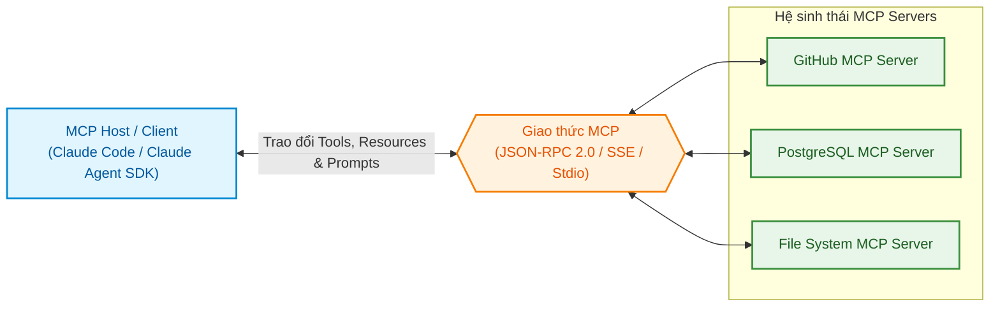
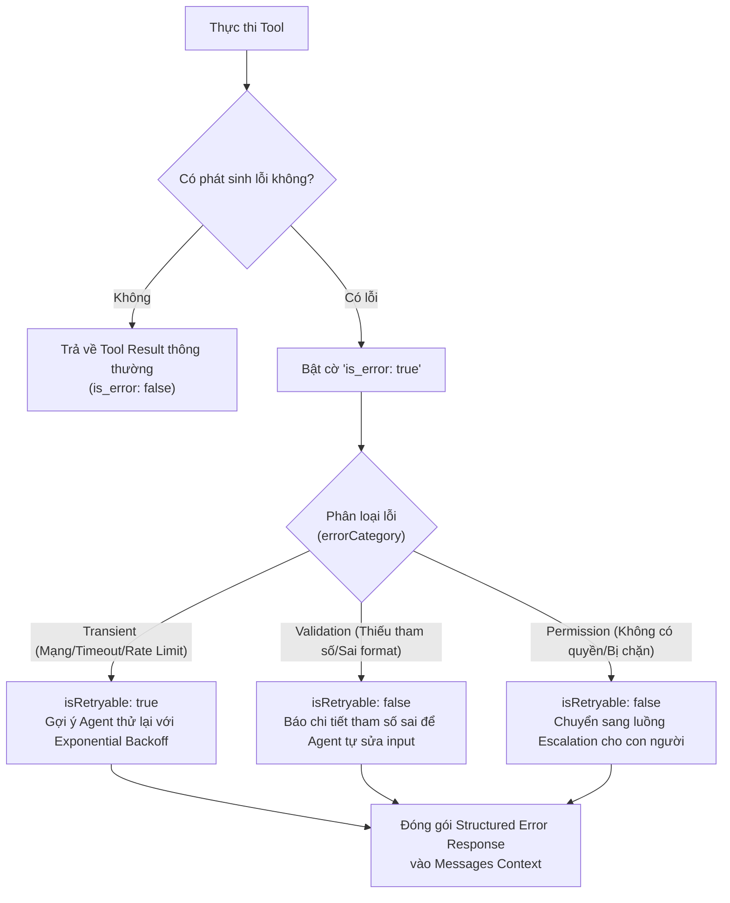

# Domain 2: Thiết kế Tool & Tích hợp MCP (18%)

:::info 🎯 Mục tiêu Domain 2
Domain 2 chiếm **18% trọng số đề thi (khoảng 11 câu hỏi)**. Domain này tập trung vào kỹ thuật thiết kế giao diện công cụ (**Tool Interface Design**), kỹ thuật phân định ranh giới mô tả (**Boundary Definition**), cấu trúc phản hồi lỗi có cấu trúc (**Structured MCP Error Handling**), và quy tắc phân bổ công cụ theo nguyên tắc đặc quyền tối thiểu.
:::

---

## 1. Giải phẫu Khái niệm Cốt lõi (Definition Anatomy)

### Model Context Protocol (MCP) là gì?
> **Định nghĩa chuẩn kỹ thuật:**  
> **Model Context Protocol (MCP)** là một giao thức mở tiêu chuẩn hóa (*Open Standard Protocol*), thiết lập kiến trúc Client–Server an toàn cho phép các ứng dụng điều khiển AI (*Hosts / Clients*) kết nối đồng bộ với các máy chủ công cụ bên ngoài (*Servers*) để truy cập tài nguyên dữ liệu chỉ đọc (*Resources*), thực thi hàm nghiệp vụ (*Tools*), và nạp các mẫu chỉ dẫn (*Prompts*).



### Mổ xẻ Từ khóa (Keyword Anatomy):
1. **MCP Host / Client:** Ứng dụng AI trực tiếp tương tác với người dùng (như Claude Code hoặc ứng dụng viết bằng Claude Agent SDK). Host chịu trách nhiệm quản lý kết nối, phân phối tool và kiểm soát quyền hạn.
2. **MCP Server:** Tiến trình độc lập (chạy qua `stdio` hoặc mạng qua `SSE`) công khai các capability cho Host. Server không chứa trí tuệ nhân tạo mà đóng vai trò là "cây cầu" kết nối vào cơ sở dữ liệu, API hoặc hệ thống file.
3. **Tools vs Resources:**
   - **Tools:** Các hàm có khả năng thực thi, có thể thay đổi trạng thái hệ thống (*State-mutating actions* như tạo issue, sửa file, gửi email).
   - **Resources:** Dữ liệu ngữ cảnh chỉ đọc (*Read-only context* như nội dung file, schema bảng dữ liệu).

---

## 2. Chi tiết 5 Task Statements theo Chuẩn Đề thi

### Task 2.1: Thiết kế Tool Interface với Mô tả Rõ ràng và Ranh giới Rạch ròi
- **Bản chất kỹ thuật:**  
  Trong mô hình Function Calling của LLM, **Tool Description chính là cơ chế định tuyến (Routing mechanism) duy nhất**. LLM không nhìn thấy mã nguồn bên trong tool; nó chỉ đọc `name` và `description` để quyết định có gọi tool hay không.

- **Vấn đề Misrouting (Chọn nhầm công cụ):**  
  Khi hai tool có mô tả quá ngắn hoặc chồng chéo chức năng (ví dụ: `analyze_content` với mô tả *"Analyzes content"* và `analyze_document` với mô tả *"Analyzes document"*), LLM sẽ chọn ngẫu nhiên dựa trên xác suất từ ngữ, dẫn đến sai sót nghiêm trọng trong production.

#### Ma trận Thiết kế Tool Description:

| Thành phần | Tool Description Sơ sài (Dễ Misrouting) | Tool Description Chuẩn mực (Production Grade) |
| :--- | :--- | :--- |
| **Tên tool** | `analyze_content` | `extract_web_results` |
| **Mô tả mục đích** | *"Analyzes web content and data"* | *"Trích xuất dữ liệu có cấu trúc từ trang web đã được fetch. CHỈ dùng cho dữ liệu HTML/Web text, KHÔNG dùng cho file PDF hoặc local file."* |
| **Ví dụ truy vấn (Examples)** | Không có | *"Ví dụ query phù hợp: 'Trích xuất giá sản phẩm từ link e-commerce này', 'Lấy bảng biểu từ bài báo'."* |
| **Ranh giới (Boundaries)** | Không có | *"Nếu người dùng yêu cầu phân tích file nội bộ trong kho chứa, hãy dùng tool `read_file` thay thế."* |

:::caution ⚠️ Cạm bẫy System Prompt
Cách diễn đạt trong **System Prompt** có thể vô tình làm vô hiệu hóa Tool Description được viết tốt. Nếu System Prompt chứa câu lệnh nhạy cảm với từ khóa (Keyword-sensitive instruction) như: *"Bất cứ khi nào người dùng nhắc đến từ 'phân tích', bạn phải dùng analyze_content"*, LLM sẽ bị thiên kiến và bỏ qua công cụ `analyze_document` phù hợp hơn.
:::

---

### Task 2.2: Triển khai Structured Error Response cho MCP Tool

Khi một tool gặp sự cố trong quá trình thực thi, thay vì ném ra ngoại lệ (throw unhandled exception) làm sập toàn bộ Agentic loop, công cụ phải trả về một **phản hồi lỗi có cấu trúc**:



#### Quy chuẩn Cấu trúc Lỗi chuẩn MCP:
```json
{
  "isError": true,
  "content": [
    {
      "type": "text",
      "text": "Lỗi kết nối cơ sở dữ liệu: Database connection timed out after 5000ms."
    }
  ],
  "_meta": {
    "errorCategory": "transient",
    "isRetryable": true,
    "retryAfterSeconds": 3
  }
}
```
* **Tại sao cần `is_error: true`?** Cờ này báo hiệu cho LLM biết lượt gọi tool đã thất bại. Model sẽ không ảo tưởng rằng tác vụ đã hoàn thành mà sẽ chủ động đọc thông điệp lỗi để đưa ra hành động khắc phục (Self-correction).

---

### Task 2.3: Phân bổ Tool và Cấu hình Tham số `tool_choice`

Anthropic API cung cấp tham số `tool_choice` với 4 chế độ hoạt động chính thức:

| Giá trị `tool_choice` | Hành vi của Mô hình | Use Case trong Production |
| :--- | :--- | :--- |
| `{"type": "auto"}` | Model tự do quyết định có gọi tool hay trả lời văn bản. *(Mặc định khi có `tools`)* | Trò chuyện tổng quát, linh hoạt giữa giải thích và thao tác. |
| `{"type": "any"}` | **Bắt buộc** model phải gọi ít nhất một tool bất kỳ trong danh sách. Không được trả về text thuần. | Giai đoạn thực thi tác vụ chuyên biệt, bắt buộc Agent phải hành động. |
| `{"type": "tool", "name": "..."}` | **Bắt buộc** model phải gọi chính xác công cụ được chỉ định tên. | Ép buộc xuất dữ liệu có cấu trúc (Structured Output qua Tool Use). |
| `{"type": "none"}` | Ngăn chặn model gọi bất kỳ tool nào, chỉ trả về văn bản tự nhiên. | Khi muốn tạm khóa khả năng gọi tool để tổng kết hoặc giải thích. |

:::tip 💡 Điểm lưu ý kỹ thuật
Khi đặt `tool_choice` là `any` hoặc `tool`, API sẽ tự động prefill tin nhắn của Assistant để ép gọi tool. Do đó, model sẽ **không xuất ra lời giải thích tự nhiên** trước khối `tool_use`. Nếu muốn model vừa giải thích vừa gọi tool, hãy dùng `tool_choice: "auto"` kết hợp chỉ dẫn rõ trong prompt.
:::

---

### Task 2.4: Tích hợp MCP Server và Chính sách Cấp quyền (Permission Policies)

Trong các hệ thống sử dụng Claude Code hoặc Managed Agents, công cụ MCP cần được quản lý bằng các chính sách cấp quyền chặt chẽ:

#### 3 Loại Permission Policies Chính thức:
1. **`always_allow` (Tự động chạy):** Công cụ thực thi tức thì mà không cần hỏi người dùng. Mặc định dành cho tập công cụ đọc cơ bản (`agent_toolset`).
2. **`always_ask` (Luôn hỏi phê duyệt):** Phiên làm việc sẽ tạm dừng (pause) và chờ người dùng bấm chấp thuận trước khi lệnh được chạy. **Đây là chính sách mặc định của tất cả MCP Toolsets** nhằm đảm bảo mã lệnh từ server bên ngoài không tự ý can thiệp vào máy của bạn.
3. **`auto` (Đánh giá thông minh theo rủi ro):** Server tự động đánh giá từng lượt gọi công cụ dựa trên bối cảnh:
   - Nếu an toàn: Tự động chạy như `always_allow`.
   - Nếu rủi ro cao: Từ chối thực thi và trả về: `Permission to use {tool_name} has been denied.` kèm `is_error: true`.
   - Nếu không chắc chắn: Tạm dừng hỏi ý kiến người dùng.

---

### Task 2.5: Áp dụng Built-in Tools Hiệu quả (Grep, Glob vs Bash)

- **Khi nào dùng `Grep` và `Glob` thay vì `Bash`?**
  - **Hiệu năng & Token:** Tool `Glob` (tìm file theo pattern) và `Grep` (tìm nội dung file bằng ripgrep) chạy ở tầng hệ thống tối ưu, trả về đúng danh sách file/dòng code cần thiết.
  - **Bảo mật:** Dùng lệnh Bash `find . -name "*.ts"` hay `grep -r "..."` tiềm ẩn nguy cơ command injection và tạo ra tiến trình shell nặng nề.
- **Khi nào dùng `Edit` thay vì `Write`?**
  - `Edit` thực hiện thay thế chính xác một khối chuỗi (`old_string` $\rightarrow$ `new_string`). Nó chỉ gửi phần khác biệt nhỏ, tiết kiệm token tối đa và giữ nguyên toàn bộ comment xung quanh.
  - `Write` ghi đè toàn bộ tệp, chỉ nên dùng khi tạo tệp mới hoàn toàn hoặc tệp cấu hình rất ngắn.

---

## 3. Mẹo Thi & Cạm bẫy Thường Gặp ở Domain 2

:::tip 💡 Mẹo làm bài thi Domain 2
- Khi đề bài mô tả hiện tượng **Agent thường xuyên chọn nhầm giữa 2 công cụ tương tự nhau**: Bước đầu tiên và đúng đắn nhất là **mở rộng mô tả (Tool Description)** của từng tool (nêu rõ input formats, example queries, edge cases và boundaries). Tuyệt đối không vội vàng gộp 2 tool lại làm một hay viết thêm routing classifier phức tạp.
- Khi một tool trả về lỗi do hệ thống bên ngoài tạm ngưng (Transient Error): Phản hồi lỗi phải đính kèm **`is_error: true`** và cờ đánh dấu **`isRetryable: true`** để Agent biết đường thử lại.
:::

:::caution ⚠️ Cạm bẫy trắc nghiệm dễ mất điểm
- **Cạm bẫy Gộp Tool:** Đề thi thường đưa ra phương án *"Gộp get_customer và lookup_order thành một tool entity_lookup duy nhất tự đoán identifier"*. Đây là phương án chống lại nguyên tắc Clean Code và Single Responsibility, làm code backend phức tạp và khó kiểm soát lỗi.
- **Cạm bẫy Cấp quyền:** Cho phép toàn bộ MCP servers chạy với `always_allow` trong môi trường sản xuất là một vi phạm bảo mật nghiêm trọng.
:::

---

## 4. 📚 Tài liệu Tham chiếu Chính thức từ Anthropic

- [Chính sách Cấp quyền Công cụ (Permission Policies)](file:///Users/anhtus/Documents/Development/Documentary/vuanhtu1993.github.io/sources/documentations/platform.claude.com/docs/en/managed-agents/permission-policies.md) — Cơ chế `always_allow`, `always_ask`, và `auto` đánh giá rủi ro.
- [Định nghĩa Công cụ & Tham số `tool_choice`](file:///Users/anhtus/Documents/Development/Documentary/vuanhtu1993.github.io/sources/documentations/platform.claude.com/docs/en/agents-and-tools/tool-use/define-tools.md) — 4 tùy chọn `auto`, `any`, `tool`, `none`.
- [Tích hợp MCP Connector](file:///Users/anhtus/Documents/Development/Documentary/vuanhtu1993.github.io/sources/documentations/platform.claude.com/docs/en/managed-agents/mcp-connector.md) — Cấu hình kết nối MCP server và xử lý lỗi.
- [Tài liệu Quản lý MCP trong Claude Code](file:///Users/anhtus/Documents/Development/Documentary/vuanhtu1993.github.io/sources/documentations/code.claude.com/docs/en/mcp.md) — Cấu hình `.mcp.json` và phạm vi chia sẻ team.

---

> *Made by Anh Tu - Share to be share*
