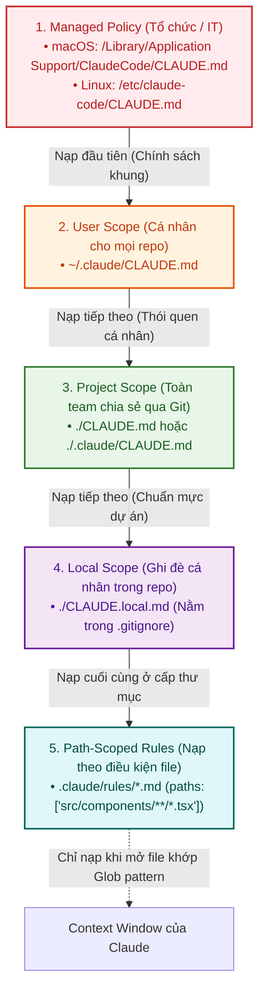
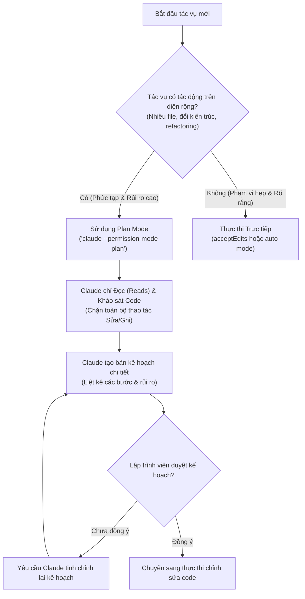
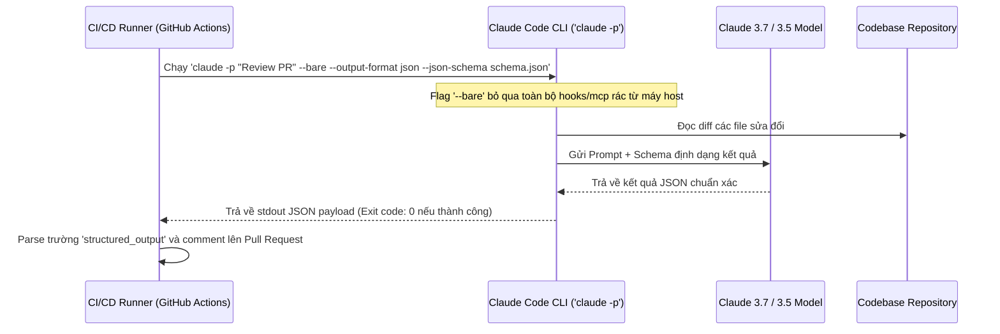

# Domain 3: Cấu hình & Workflow Claude Code (20%)

:::info 🎯 Mục tiêu Domain 3
Domain 3 chiếm **20% trọng số đề thi (khoảng 12 câu hỏi)**. Domain này đánh giá năng lực cấu hình công cụ **Claude Code** cấp độ chuyên gia: phân tầng chỉ dẫn (`CLAUDE.md`), quản lý quy tắc có điều kiện (`.claude/rules/`), xây dựng Custom Commands & Skills, vận dụng **Plan Mode**, và tích hợp pipeline CI/CD tự động hóa.
:::

---

## 1. Giải phẫu Khái niệm Cốt lõi (Definition Anatomy)

### Tại sao Cấu hình Claude Code cần phải Phân tầng (Hierarchy)?
> **Bản chất kiến trúc:**  
> Trong các dự án phần mềm doanh nghiệp lớn (Monorepo), một file chỉ dẫn duy nhất ở thư mục gốc sẽ nhanh chóng phình to vượt quá 1.000 dòng. Điều này gây ra hiện tượng **Suy giảm Tuân thủ (Adherence Degradation)**: LLM bị quá tải ngữ cảnh, bắt đầu bỏ qua các quy tắc quan trọng hoặc áp dụng nhầm convention của frontend vào backend. 

Hệ thống cấu hình phân tầng của Claude Code giải quyết triệt để bài toán này bằng cách tách biệt phạm vi (Scoping):



---

## 2. Chi tiết 6 Task Statements theo Chuẩn Đề thi

### Task 3.1: Cấu hình `CLAUDE.md` với Phân tầng và Tổ chức Modular
- **4 Cấp độ Phạm vi (Scope Hierarchy & Load Order):**
  1. **Managed Policy:** Do phòng IT/DevOps quản lý ở cấp hệ điều hành. Thiết lập các tiêu chuẩn an toàn và bảo mật không thể bị ghi đè.
  2. **User Instructions (`~/.claude/CLAUDE.md`):** Các sở thích và thói quen cá nhân của lập trình viên, áp dụng cho mọi dự án trên máy.
  3. **Project Instructions (`./CLAUDE.md` hoặc `./.claude/CLAUDE.md`):** Các quy ước chung của team được commit vào Git (lệnh build, test, kiến trúc).
  4. **Local Instructions (`./CLAUDE.local.md`):** Các ghi chú riêng cho dự án hiện tại (URL sandbox cá nhân, dữ liệu test), luôn thêm vào `.gitignore`.

#### 3 Quy chuẩn Vàng khi Viết `CLAUDE.md`:
- **Độ dài mục tiêu:** Giữ **dưới 200 dòng**. Đưa các quy trình phức tạp sang Skills hoặc Scoped Rules.
- **Cú pháp Import `@`:** Hỗ trợ import modular: `@docs/architecture.md` (hỗ trợ đệ quy tối đa **4 cấp / hops**).
- **Nội dung trọng tâm:** Chỉ ghi những gì Claude không thể tự suy ra từ code (lệnh build/test thường dùng, các nguyên tắc "luôn luôn / không bao giờ").

---

### Task 3.2: Tạo và Cấu hình Custom Slash Commands và Skills

Claude Code cho phép mở rộng khả năng bằng hai cơ chế chính:

| Tiêu chí | Custom Slash Commands (`.claude/commands/*.md`) | Agent Skills (`.claude/skills/<name>/SKILL.md`) |
| :--- | :--- | :--- |
| **Vị trí lưu trữ** | File markdown đơn lẻ tại `.claude/commands/<tên>.md` | Thư mục chuyên biệt tại `.claude/skills/<tên>/SKILL.md` |
| **Cách kích hoạt** | Người dùng gõ lệnh `/<tên>` trên terminal | Gõ `/<tên>` hoặc để Claude tự động kích hoạt khi tác vụ khớp mô tả |
| **Tính năng nâng cao** | Phù hợp cho các prompt template ngắn, checklist đơn giản (ví dụ: `/review`) | Hỗ trợ đính kèm mã script phụ trợ, tài liệu tham khảo và thư mục con |
| **Cấu hình Frontmatter** | Hỗ trợ các trường cơ bản | Hỗ trợ đầy đủ: `allowed-tools`, `context: fork`, `argument-hint`, `model` |

:::tip 💡 Trả lời Câu hỏi số 4 của Đề thi
Khi bạn muốn tạo một custom command `/review` dùng chung cho toàn bộ thành viên trong nhóm mỗi khi họ clone hoặc pull repository:
$\rightarrow$ **Vị trí bắt buộc phải lưu file là:** `.claude/commands/review.md` (được commit vào git).
:::

---

### Task 3.3: Áp dụng Path-Specific Rules với `.claude/rules/`
- **Bài toán thực tế:** Codebase có nhiều khu vực với quy ước đối nghịch nhau:
  - React components dùng functional style và CSS modules.
  - API handlers dùng async/await với định dạng `{ data, error }`.
  - Các file test (`*.test.tsx`) nằm rải rác cạnh component nhưng phải tuân thủ cùng một quy ước mock dữ liệu.
- **Giải pháp Chuẩn mực:** Đặt các file rule vào thư mục `.claude/rules/*.md` kết hợp trường YAML frontmatter `paths`.

#### Ví dụ Cấu hình Scoped Rule (`.claude/rules/testing.md`):
```markdown
---
paths:
  - "**/*.test.ts"
  - "**/*.test.tsx"
---

# Quy ước Kiểm thử Toàn dự án
- Luôn sử dụng Vitest và React Testing Library.
- Mock tất cả các API calls bằng MSW (Mock Service Worker).
- Không kiểm tra implementation detail, chỉ kiểm tra hành vi người dùng.
```

:::info 📌 Cơ chế hoạt động của `paths`
Claude Code chỉ nạp nội dung của `.claude/rules/testing.md` vào Context Window khi Claude bắt đầu đọc, viết hoặc sửa đổi một file có đường dẫn khớp với glob pattern `**/*.test.ts`. Khi Claude chuyển sang sửa file css hay README, rule này sẽ không nạp, giúp giữ Context Window luôn tinh gọn.
:::

---

### Task 3.4: Khi nào Dùng Plan Mode so với Thực thi Trực tiếp?

Claude Code cung cấp nhiều chế độ cấp quyền (**Permission Modes**):



#### Ma trận Lựa chọn:
- **Chọn Plan Mode (`plan`):**
  - Tái cấu trúc ứng dụng monolithic thành microservices.
  - Di chuyển cơ sở dữ liệu lớn (Database Migration).
  - Khám phá và phân tích một codebase hoàn toàn mới.
- **Chọn Thực thi Trực tiếp (`direct execution`):**
  - Sửa một lỗi cú pháp hoặc một bug cục bộ đã rõ nguyên nhân.
  - Thêm một unit test cho một hàm độc lập.

---

### Task 3.5: Kỹ thuật Tinh chỉnh Lặp (Iterative Refinement) & Bộ nhớ
- **Lệnh `/compact`:** Khi phiên làm việc kéo dài và context window đạt giới hạn, chạy `/compact` để tóm tắt các phát hiện quan trọng, giải phóng token và tiếp tục làm việc mà không làm mất sợi dây suy luận.
- **Lệnh `/memory`:** Mở trực tiếp file `CLAUDE.md` trong trình biên tập ngay giữa phiên làm việc để cập nhật quy ước mới.
- **Lệnh `/rewind`:** Khôi phục nhanh lại trạng thái codebase trước một lượt chỉnh sửa sai của Claude mà không cần dùng `git checkout` thủ công.

---

### Task 3.6: Tích hợp Claude Code vào CI/CD Pipeline (Headless Automation)

Để chạy Claude Code hoàn toàn tự động trong GitHub Actions, GitLab CI hoặc runner không có con người tương tác:



#### Các Cờ CLI Bắt buộc cho Môi trường CI/CD:
1. **`-p` / `--print` (Non-interactive Mode):** Chạy Claude Code ở chế độ không tương tác, nhận prompt từ dòng lệnh hoặc pipe qua stdin và in kết quả ra stdout rồi thoát.
2. **`--bare`:** Bỏ qua việc tự động nạp hooks cá nhân, custom commands, plugins, và auto memory từ máy chủ. **Bắt buộc dùng trong CI** để đảm bảo môi trường thực thi hoàn toàn sạch và có tính lặp lại (reproducible).
3. **`--output-format json`:** Trả về kết quả dưới dạng JSON có cấu trúc (gồm kết quả, session ID, lượng token tiêu thụ và chi phí).
4. **`--json-schema <schema>`:** Ép kết quả trả về tuân thủ chính xác JSON Schema; kết quả được trích xuất tại trường `structured_output`.

---

## 3. Mẹo Thi & Cạm bẫy Thường Gặp ở Domain 3

:::tip 💡 Mẹo làm bài thi Domain 3
- Khi câu hỏi yêu cầu **đảm bảo quy ước coding chỉ áp dụng cho một nhóm file cụ thể** (như React components hoặc unit tests): Đáp án luôn là tạo file trong **`.claude/rules/` với YAML frontmatter `paths`**.
- Khi câu hỏi liên quan đến **chạy tự động trong CI/CD pipeline**: Đáp án đúng luôn chứa cờ **`-p` (hoặc `--print`)** kết hợp với **`--bare`** hoặc **`--output-format json`**.
:::

:::caution ⚠️ Cạm bẫy trắc nghiệm dễ mất điểm
- **Cạm bẫy Gộp file `CLAUDE.md`:** Đề thi sẽ đưa ra phương án *"Dồn tất cả quy ước vào một file CLAUDE.md duy nhất ở thư mục gốc dưới các header riêng biệt và dựa vào việc Claude tự suy luận"*. Đây là phương án sai vì sẽ làm ô nhiễm context và giảm độ tuân thủ quy tắc của Claude.
- **Cạm bẫy Nhầm lẫn Slash Command:** Lưu lệnh custom slash command vào `.claude/rules/` hay `~/.claude/commands/` (khi muốn chia sẻ cho team) là sai. Để chia sẻ qua Git cho cả team, file phải nằm ở **`.claude/commands/*.md`** trong project.
:::

---

## 4. 📚 Tài liệu Tham chiếu Chính thức từ Anthropic

- [Khám phá Thư mục `.claude`](file:///Users/anhtus/Documents/Development/Documentary/vuanhtu1993.github.io/sources/documentations/code.claude.com/docs/en/claude-directory.md) — Toàn bộ cấu trúc thư mục, quy tắc frontmatter và file reference.
- [Quản lý Bộ nhớ và Phân tầng `CLAUDE.md`](file:///Users/anhtus/Documents/Development/Documentary/vuanhtu1993.github.io/sources/documentations/code.claude.com/docs/en/memory.md) — Chi tiết về thứ bậc nạp, scoped rules `.claude/rules/`, và cú pháp import `@`.
- [Chạy Claude Code Không tương tác trong CI/CD (Headless)](file:///Users/anhtus/Documents/Development/Documentary/vuanhtu1993.github.io/sources/documentations/code.claude.com/docs/en/headless.md) — Cấu hình cờ `-p`, `--bare`, `--output-format`, và `--json-schema`.
- [Các Chế độ Cấp quyền & Plan Mode](file:///Users/anhtus/Documents/Development/Documentary/vuanhtu1993.github.io/sources/documentations/code.claude.com/docs/en/permission-modes.md) — Chế độ `plan`, `acceptEdits`, `auto`, và ranh giới an toàn.

---

> *Made by Anh Tu - Share to be share*
