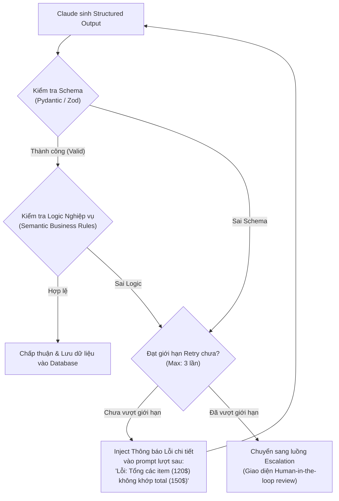
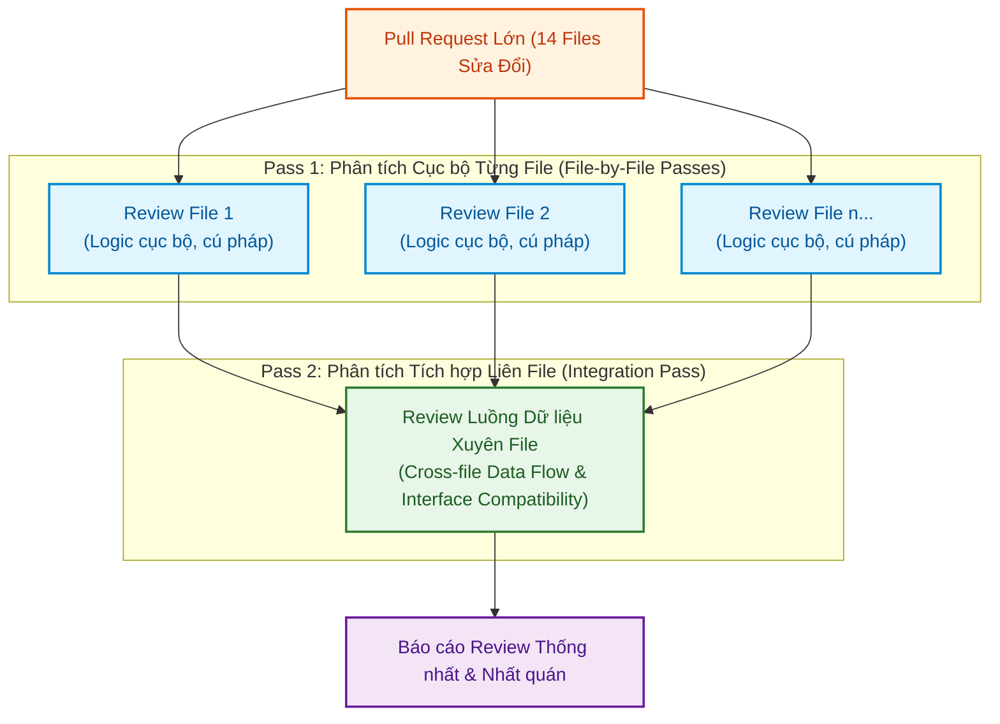

# Domain 4: Prompt Engineering & Structured Output (20%)

:::info 🎯 Mục tiêu Domain 4
Domain 4 chiếm **20% trọng số đề thi (khoảng 12 câu hỏi)**. Domain này tập trung vào kỹ thuật ép buộc dữ liệu đầu ra có cấu trúc (**Structured Outputs via Tool Use**), xây dựng vòng lặp tự sửa lỗi (**Validation & Retry Loop**), tối ưu chi phí với **Message Batches API**, và thiết kế kiến trúc **Multi-Pass & Multi-Instance Code Review** trong môi trường production.
:::

---

## 1. Giải phẫu Khái niệm Cốt lõi (Definition Anatomy)

### Structured Output trong Môi trường Production là gì?
> **Bản chất kỹ thuật:**  
> Trong các ứng dụng cấp doanh nghiệp, hệ thống phần mềm hạ tầng không thể tiêu thụ văn bản tự do (Free-form Markdown). Việc yêu cầu LLM *"Hãy trả về kết quả dạng JSON"* rồi dùng biểu thức chính quy (Regex) bóc tách rất dễ gặp lỗi do model chèn thêm lời mở đầu lịch sự (*"Dưới đây là JSON của bạn..."*) hoặc sinh sai dấu phẩy.  
> 
> Giải pháp chuẩn mực của Anthropic là **Constrained Structured Output via Tool Use**: Sử dụng cơ chế Function Calling kết hợp JSON Schema chuẩn (`strict: true`) và tham số `tool_choice: {"type": "tool", "name": "..."}` để model bắt buộc phải xuất dữ liệu theo đúng định dạng định sẵn ở tầng giải mã token (Grammar-constrained sampling).

---

## 2. Chi tiết 6 Task Statements theo Chuẩn Đề thi

### Task 4.1: Thiết kế Prompt với Tiêu chí Rõ ràng (Giảm False Positives)
- **Vấn đề trong Automated Review:**  
  Khi xây dựng bot review code tự động, vấn đề nan giải nhất không phải là sót bug mà là **Tỷ lệ Báo động Giả (False Positives) quá cao**. Bot liên tục bắt lỗi phong cách (style nitpicks), cản trở quy trình merge code của lập trình viên.
- **Giải pháp Kiến trúc:**
  - Định nghĩa bộ tiêu chí rõ ràng và có thể đo lường được (*Explicit & Measurable Criteria*): Ví dụ phân định rõ các mức độ nghiêm trọng (*Critical Security Vulnerability* vs *Informational Suggestion*).
  - Cung cấp danh sách các trường hợp được miễn trừ (*Exclusions*): Ví dụ quy định rõ bot bỏ qua việc kiểm tra naming convention nếu file nằm trong thư mục `legacy/`.

---

### Task 4.2: Áp dụng Few-Shot Prompting Nâng cao
- **Khi nào CẦN dùng Few-Shot?**
  - Khi bài toán yêu cầu phân loại các tình huống có ranh giới mong manh (Ambiguity Resolution) mà chỉ dẫn bằng lời không thể bao quát hết.
  - Cung cấp từ 5 đến 8 cặp ví dụ (Input $\rightarrow$ Desired Output) mẫu mực, đặc biệt tập trung vào các **Trường hợp Biên (Edge Cases)**.

---

### Task 4.3: Ép buộc Structured Output bằng `tool_use` và JSON Schema
- **Kỹ thuật ép buộc 100%:**
  1. Định nghĩa một Tool (ví dụ `export_invoice_data`) với tham số `input_schema` tuân thủ JSON Schema chuẩn.
  2. Truyền tham số `tool_choice: {"type": "tool", "name": "export_invoice_data"}`.
  3. Bật chế độ `strict: true` (Strict Tool Use) để đảm bảo mọi trường dữ liệu trả về đều hợp lệ về kiểu, không có trường thừa ngoài ý muốn (`additionalProperties: false`).

#### Xử lý Linh hoạt Enum và Trường Dữ liệu Mơ hồ:
- **Mẫu Thiết kế "Other + Detail String":**  
  Khi định nghĩa một trường enum (ví dụ danh mục chi phí: `TRAVEL`, `MEALS`, `EQUIPMENT`), nếu hóa đơn thực tế có thể xuất hiện chi phí ngoài danh mục, schema bắt buộc phải thiết kế thêm giá trị `"OTHER"` kết hợp với một trường chuỗi `other_detail: string` để model không bị bế tắc hoặc cố tình nhét bừa vào một danh mục sai.
- **Quy tắc Enum:** Luôn so sánh giá trị enum không phân biệt chữ hoa/thường (*Case-insensitive comparison*) để tránh lỗi khi model sinh hoa/thường khác biệt.

---

### Task 4.4: Triển khai Vòng lặp Validation, Retry & Feedback

Dù có JSON Schema, dữ liệu vẫn có thể vi phạm các ràng buộc logic nghiệp vụ (Semantic Validation, ví dụ: ngày kết thúc trước ngày bắt đầu, tổng tiền các dòng không khớp tổng hóa đơn).

:::info 📌 Kỹ thuật Feedback Injection
Khi retry, không gửi lại câu prompt cũ một cách vô ích. Bắt buộc phải **trích xuất thông báo lỗi chính xác của thư viện kiểm thực (như Pydantic ValidationError)** và nạp vào prompt lượt sau để Claude hiểu cụ thể giá trị nào sai và tự sửa đổi.
:::

---

### Task 4.5: Thiết kế Chiến lược Xử lý Hàng loạt với Message Batches API

Trong các bài toán xử lý dữ liệu lớn (như quét mã nguồn toàn bộ 500 repositories, hoặc trích xuất 50.000 tài liệu hồ sơ):

| Tiêu chí | Real-Time Messages API | Message Batches API (Chạy hàng loạt) |
| :--- | :--- | :--- |
| **Chi phí** | Giá niêm yết $100\%$ | **Giảm $50\%$ chi phí** trên toàn bộ token (Input & Output) |
| **Thời gian phản hồi** | Ngay lập tức (Streaming vài giây) | Xử lý bất đồng bộ (Phần lớn dưới 1 giờ, tối đa SLA 24 giờ) |
| **Cơ chế tương quan** | Kết nối trực tiếp qua HTTP stream | Định danh qua trường **`custom_id`** của từng request |
| **Use Case phù hợp** | Chatbot trực tiếp, trợ lý code tương tác, workflow cần kết quả ngay | Quét lỗi bảo mật qua đêm, trích xuất dữ liệu tài liệu hàng loạt |

:::caution ⚠️ Cạm bẫy Đề thi về Batch API
- Nếu một workflow yêu cầu **developer phải chờ kết quả ngay trước khi merge code (Blocking PR Workflow)**: Tuyệt đối **không được dùng Batch API** vì độ trễ có thể lên tới 24 giờ.
- Nếu một workflow là **chạy ngầm qua đêm để tạo báo cáo Technical Debt**: Lựa chọn tối ưu chi phí duy nhất là **Message Batches API**.
:::

---

### Task 4.6: Kiến trúc Review Đa Instance và Đa Pass (Multi-Pass Code Review)

Khi sử dụng Claude để review các Pull Request lớn (ví dụ PR sửa đổi 14 file liên kết chặt chẽ):

#### 1. Hiện tượng Neo Suy luận (Reasoning Anchor) ở Self-Review
- **Tại sao tự model review code do chính nó sinh ra lại kém hiệu quả?**  
  Model vẫn giữ nguyên reasoning context ban đầu trong cùng session. Nó có xu hướng tin rằng các quyết định thiết kế vừa tạo là đúng đắn (Confirmation Bias), do đó rất khó phát hiện ra các lỗi logic tinh vi.
- **Giải pháp:** Bắt buộc sử dụng một **Claude Instance độc lập thứ hai** (Fresh instance không có reasoning context ban đầu) để review code.

#### 2. Hiện tượng Pha loãng Độ chú ý (Attention Dilution) trên PR Lớn
- **Vấn đề khi Review 1 Lượt Toàn bộ 14 File:**  
  Nếu nạp cả 14 file vào một lượt gọi duy nhất, độ chú ý của model sẽ bị phân tán: nhận xét chi tiết ở 2 file đầu, bỏ qua lỗi ở các file giữa, và thậm chí mâu thuẫn (chấp thuận pattern này ở file A nhưng lại chê lỗi ở file B).

:::tip 💡 Trả lời Câu hỏi số 12 của Đề thi
Khi một đợt review duy nhất trên 14 file tạo ra kết quả chập chờn, mâu thuẫn và bỏ sót bug:  
$\rightarrow$ **Giải pháp kiến trúc đúng:** Tái cấu trúc thành **các lượt tập trung (focused passes)**: phân tích từng file riêng lẻ để tìm lỗi cục bộ, sau đó chạy một lượt tích hợp riêng (integration pass) để kiểm tra luồng dữ liệu xuyên suốt các file.
:::

---

## 3. Mẹo Thi & Cạm bẫy Thường Gặp ở Domain 4

:::tip 💡 Mẹo làm bài thi Domain 4
- Khi câu hỏi đề cập đến **tiết kiệm chi phí API cho các tác vụ phân tích chạy qua đêm**: Đáp án luôn là **Message Batches API** (tiết kiệm 50% chi phí).
- Khi câu hỏi đề cập đến việc **đánh giá code do chính Claude sinh ra**: Phương án đúng luôn là dùng **Independent Instance thứ hai** thay vì yêu cầu cùng instance đó tự phản tư (self-reflection).
:::

:::caution ⚠️ Cạm bẫy trắc nghiệm dễ mất điểm
- **Cạm bẫy Context Window lớn:** Khi gặp hiện tượng model review hời hợt trên PR nhiều file, đề thi sẽ bẫy bằng phương án *"Chuyển sang model có context window lớn hơn để đọc hết 14 file trong một lượt"*. Đây là đáp án sai vì context window lớn không giải quyết được vấn đề *pha loãng độ chú ý (attention dilution)*.
- **Cạm bẫy Ép Developer:** Phương án *"Yêu cầu developer tự chia nhỏ PR thành các phần 3 file trước khi automated review chạy"* là phương án đẩy gánh nặng sang con người mà không cải thiện kiến trúc hệ thống.
:::

---

## 4. 📚 Tài liệu Tham chiếu Chính thức từ Anthropic

- [Xuất Dữ liệu Cấu trúc với JSON Schema & Tool Use](file:///Users/anhtus/Documents/Development/Documentary/vuanhtu1993.github.io/sources/documentations/platform.claude.com/docs/en/build-with-claude/structured-outputs.md) — Hướng dẫn Strict Mode, giới hạn schema và xử lý enum.
- [Xử lý Hàng loạt Bất đồng bộ với Message Batches API](file:///Users/anhtus/Documents/Development/Documentary/vuanhtu1993.github.io/sources/documentations/platform.claude.com/docs/en/build-with-claude/batch-processing.md) — Chiết khấu 50% chi phí, SLA 24h và đối soát `custom_id`.
- [Mô hình Suy luận Mở rộng & Neo Nhận thức (Extended Thinking)](file:///Users/anhtus/Documents/Development/Documentary/vuanhtu1993.github.io/sources/documentations/platform.claude.com/docs/en/build-with-claude/thinking.md) — Giải thích cơ chế token suy luận và giới hạn của self-review.

---

> *Made by Anh Tu - Share to be share*
