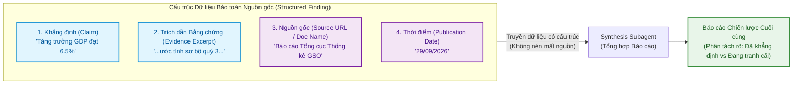
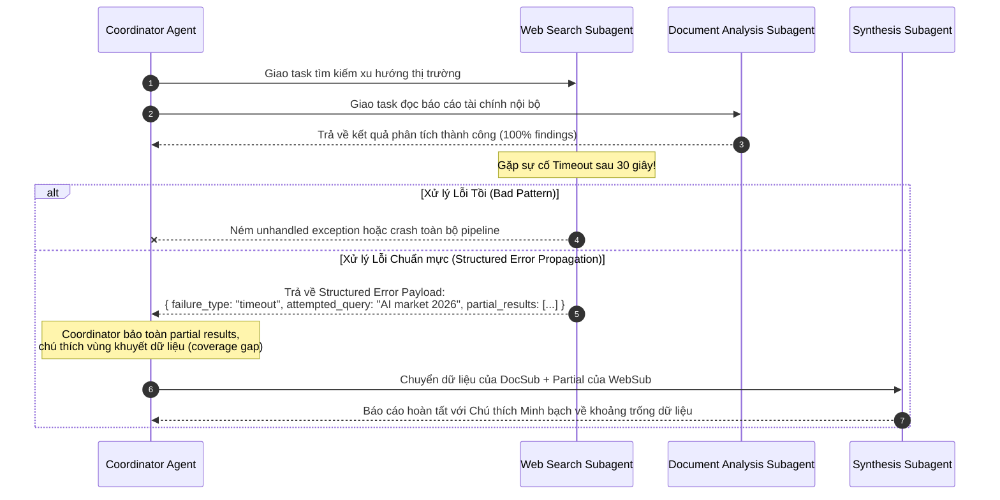

# Domain 5: Quản lý Context & Độ tin cậy (15%)

:::info 🎯 Mục tiêu Domain 5 [Khôi phục Toàn diện]
Domain 5 chiếm **15% trọng số đề thi (khoảng 9 câu hỏi)**. Đây là nội dung từng bị thất thoát trong các bản dịch tự động trước đây. Domain này đánh giá năng lực bảo vệ **Context Window**, xử lý sự cố đứt gãy mạng/timeout trong hệ thống Multi-Agent (**Error Propagation**), cơ chế bảo toàn nguồn gốc thông tin (**Information Provenance**), và thiết kế quy trình **Escalation** (chuyển giao cho con người) chuẩn mực.
:::

---

## 1. Giải phẫu Khái niệm Cốt lõi (Definition Anatomy)

### Information Provenance (Bảo toàn Nguồn gốc Dữ liệu) là gì?
> **Định nghĩa chuẩn kỹ thuật:**  
> **Information Provenance** là khả năng theo dõi và duy trì xuyên suốt chuỗi liên kết có cấu trúc (*Claim-Source Mapping*) giữa một khẳng định thông tin cụ thể (*Claim*), đoạn trích dẫn bằng chứng nguyên văn (*Verbatim Excerpt*), định danh tài liệu nguồn (*Source URL / Document ID*), và mốc thời gian công bố (*Publication Date*), đảm bảo nguồn gốc không bị biến dạng hoặc đánh mất trong các bước tóm tắt nén dữ liệu của hệ thống Multi-Agent.

---

## 2. Chi tiết 6 Task Statements theo Chuẩn Đề thi

### Task 5.1: Quản lý Context Hội thoại qua Tương tác Multi-Turn
- **Hiểm họa từ Verbose Tool Outputs:**  
  Khi các tool đọc file hoặc gọi API trả về dữ liệu quá dài (JSON thô hàng ngàn dòng, nội dung toàn bộ file mã nguồn), Context Window sẽ bị lấp đầy nhanh chóng. Hậu quả là các chỉ dẫn quan trọng của System Prompt ban đầu hoặc ràng buộc của người dùng bị "đẩy" ra xa (Context displacement), dẫn đến agent mất tập trung.
- **3 Chiến lược Kiểm soát Ngữ cảnh Chuẩn mực:**
  1. **Trích xuất Fact có Cấu trúc (Extract Structured Facts):** Sau khi nhận output dài từ tool, chỉ trích xuất các trường dữ liệu cốt lõi đưa vào context hội thoại, loại bỏ các trường rác.
  2. **Tập tin Scratchpad (Session Scratchpad Files):** Sử dụng một file tạm (ví dụ `scratchpad.md`) để agent ghi chép các phát hiện trung gian xuyên suốt các lượt làm việc, thay vì nhồi nhét toàn bộ log vào context.
  3. **Ủy quyền cho Subagent (Subagent Delegation):** Phân chia tác vụ đọc tài liệu đồ sộ cho một subagent riêng biệt. Subagent làm việc trong context window độc lập và chỉ gửi trả lại bản tóm tắt tinh gọn cho Coordinator.

---

### Task 5.2: Thiết kế Pattern Leo thang (Escalation) và Xử lý Sự Mơ hồ
- **Hiệu chuẩn Tỷ lệ First-Contact Resolution (FCR):**  
  Mục tiêu của một Support Agent tự động thường là đạt tỷ lệ tự giải quyết trên $80\%$. Nếu Agent quá rụt rè (leo thang cả những ca đơn giản như đổi hàng có ảnh chụp lỗi rõ ràng), FCR sẽ sụt giảm. Ngược lại, nếu Agent quá liều lĩnh (tự ý xử lý các trường hợp ngoại lệ về chính sách hoàn tiền), hệ thống sẽ gây thiệt hại tài chính.

#### 3 Điều kiện Bắt buộc Phải Leo thang (Mandatory Escalation Conditions):
1. **Lỗ hổng Chính sách (Policy Gaps):** Yêu cầu của khách hàng nằm ngoài phạm vi được quy định trong tài liệu hướng dẫn nghiệp vụ của Agent.
2. **Khách hàng Yêu cầu Trực tiếp (Explicit Customer Request):** Khách hàng thể hiện rõ mong muốn gặp nhân viên con người.
3. **Bế tắc Không thể Tiến triển (Deadlock / Inability to make progress):** Agent đã thử lại nhiều lần hoặc gặp mâu thuẫn dữ liệu không thể tự hòa giải.

---

### Task 5.3: Chiến lược Lan truyền Lỗi (Error Propagation) trong Multi-Agent

Một trong những bài toán hóc búa nhất của hệ thống điều phối đa Agent là **xử lý khi một Subagent gặp sự cố (Timeout hoặc đứt mạng)**:

:::tip 💡 Trả lời Câu hỏi số 8 của Đề thi
Khi Web Search Subagent bị timeout trong lúc nghiên cứu một chủ đề phức tạp:  
$\rightarrow$ **Thiết kế đúng đắn:** Subagent bắt lỗi timeout và trả về **ngữ cảnh lỗi có cấu trúc (Structured Error Context)** bao gồm loại lỗi (`failure_type`), câu query đã thử (`attempted_query`), và bất kỳ kết quả thu thập được trước khi ngắt (`partial_results`). Coordinator tiếp tục tổng hợp báo cáo dựa trên kết quả từng phần và **chú thích rõ khoảng trống dữ liệu (coverage gap)** trong bản báo cáo cuối cùng.
:::

---

### Task 5.4: Quản lý Ngữ cảnh khi Khám phá Codebase Lớn
- **Nguyên tắc Vàng:** *Tuyệt đối không dùng công cụ đọc toàn bộ file khi mới bắt đầu khảo sát codebase.*
- **Chiến lược Tìm kiếm có Định hướng (Targeted Exploration):**
  1. Dùng `Glob` để khảo sát cấu trúc thư mục tổng thể.
  2. Dùng `Grep` để định vị chính xác vị trí của hàm, class hoặc biến quan tâm.
  3. Chỉ dùng lệnh `Read` trên một **khoảng dòng cụ thể (Targeted line range)** để kiểm tra logic.
  4. Tạo bản tóm tắt giao diện module (Module Interface Summary) để giữ trong context làm việc thay vì đọc lại nhiều lần.

---

### Task 5.5: Quy trình Human-in-the-Loop và Hiệu chỉnh Độ Tin cậy (Confidence Calibration)
- **Bản chất của Độ tự tin (Self-Reported Confidence):**  
  LLM thường có xu hướng "tự tin thái quá" (Overconfident). Độ tự tin do model tự chấm điểm không đồng nhất với độ chính xác thực tế.
- **Cơ chế Định tuyến Dựa trên Độ tin cậy (Confidence-based Routing):**
  - Điểm tin cậy $\ge 90\%$: Tự động phê duyệt và thực thi.
  - Điểm tin cậy $< 90\%$: Định tuyến sang hàng đợi của con người (Human Review Queue).
  - Gói dữ liệu chuyển giao cho con người (Review Payload) phải đính kèm: **Quyết định đề xuất, Bằng chứng trích dẫn, và Chuỗi suy luận (Reasoning chain)** để con người kiểm tra nhanh nhất.

---

### Task 5.6: Bảo toàn Nguồn gốc & Xử lý Dữ liệu Xung đột Đa nguồn

Khi tổng hợp thông tin từ nhiều nguồn tin khác nhau (ví dụ: nghiên cứu thị trường từ báo cáo tài chính của các công ty chứng khoán):

#### 1. Quy tắc Bảo toàn Nguồn gốc (Provenance Preservation):
Mỗi thông tin tìm thấy bắt buộc phải được đóng gói kèm 4 trường:
1. `claim`: Nhận định thông tin.
2. `evidence_excerpt`: Đoạn trích dẫn nguyên văn làm bằng chứng.
3. `source_url` hoặc `document_name`: Tên tài liệu nguồn.
4. `publication_date`: Ngày công bố dữ liệu.

#### 2. Xử lý khi Số liệu Xung đột giữa Các Nguồn Uy tín:
- **Tình huống:** Báo cáo A (GSO) công bố tỷ lệ tăng trưởng là $6.5\%$, trong khi Báo cáo B (World Bank) công bố là $6.8\%$. Cả hai nguồn đều có độ tin cậy tương đương.
- **Hành vi Sai lầm:** Agent tự ý chọn một số liệu hoặc tự tính trung bình cộng thành $6.65\%$.
- **Hành vi Chuẩn mực của Claude Architect:**
  - Giữ nguyên cả hai số liệu trong báo cáo.
  - Cấu trúc bản báo cáo phân tách thành 2 phần rõ rệt: **Những phát hiện đã được xác lập vững chắc (Well-established findings)** và **Những phát hiện còn tranh cãi kèm bối cảnh phương pháp luận (Contested findings with methodological context)**.
- **Yếu tố Thời gian (Temporal Data):** Rất nhiều "mâu thuẫn" thực chất là do số liệu được thu thập ở hai thời điểm khác nhau. Việc bắt buộc có `publication_date` giúp tránh việc ngộ nhận sự thay đổi theo thời gian là mâu thuẫn logic.

---

## 3. Mẹo Thi & Cạm bẫy Thường Gặp ở Domain 5

:::tip 💡 Mẹo làm bài thi Domain 5
- Khi câu hỏi đề cập đến **xử lý lỗi subagent timeout**: Đáp án luôn là **trả về structured error context kèm partial results và chú thích coverage gap**, tuyệt đối không chọn phương án retry vô tận hay làm sập pipeline.
- Khi câu hỏi đề cập đến **hai nguồn tin uy tín đưa ra số liệu thống kê xung đột nhau**: Đáp án đúng luôn là **giữ nguyên cả hai giá trị, ghi rõ nguồn trích dẫn và phân tách rõ phần thông tin chắc chắn vs phần còn tranh luận**.
:::

:::caution ⚠️ Cạm bẫy trắc nghiệm dễ mất điểm
- **Cạm bẫy Tự hòa giải Số liệu:** Đề thi sẽ đưa ra phương án *"Agent chọn số liệu của nguồn công bố gần nhất hoặc tự tính trung bình"*. Đây là phương án vi phạm tính trung thực và bảo toàn thông tin.
- **Cạm bẫy Khám phá Codebase:** Chọn phương án *"Đọc toàn bộ file để hiểu đầy đủ ngữ cảnh trước khi sửa"* trong một codebase lớn là đáp án sai vì gây lãng phí context nghiêm trọng.
:::

---

## 4. 📚 Tài liệu Tham chiếu Chính thức từ Anthropic

- [Cơ chế Trích dẫn & Nguồn gốc Dữ liệu (Citations API)](file:///Users/anhtus/Documents/Development/Documentary/vuanhtu1993.github.io/sources/documentations/platform.claude.com/docs/en/build-with-claude/citations.md) — Định dạng trích dẫn nguyên văn `cited_text` và tài liệu nguồn.
- [Quản lý Ngữ cảnh Công cụ (Manage Tool Context)](file:///Users/anhtus/Documents/Development/Documentary/vuanhtu1993.github.io/sources/documentations/platform.claude.com/docs/en/agents-and-tools/tool-use/manage-tool-context.md) — Kỹ thuật trích xuất fact và ngăn chặn phình to ngữ cảnh.
- [Quản lý Bộ nhớ Phiên (Session Memory)](file:///Users/anhtus/Documents/Development/Documentary/vuanhtu1993.github.io/sources/documentations/platform.claude.com/docs/en/managed-agents/memory.md) — Lưu trữ ghi chú và trạng thái xuyên suốt phiên.
- [Làm việc với Codebase Lớn trong Claude Code](file:///Users/anhtus/Documents/Development/Documentary/vuanhtu1993.github.io/sources/documentations/code.claude.com/docs/en/large-codebases.md) — Chiến lược phân vùng ngữ cảnh và khảo sát mục tiêu.

---

> *Made by Anh Tu - Share to be share*
