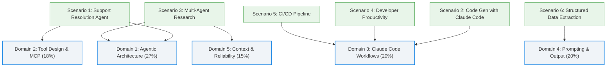

# Claude Certified Architect – Foundations (CCAR-F) Study Guide Series Implementation Plan

> **For agentic workers:** REQUIRED SUB-SKILL: Use superpowers:subagent-driven-development (recommended) or superpowers:executing-plans to implement this plan task-by-task. Steps use checkbox (`- [ ]`) syntax for tracking.

**Goal:** Xây dựng bộ cẩm nang học tập 7 phần hoàn chỉnh cho chứng chỉ Claude Certified Architect – Foundations (CCAR-F) trong thư mục `docs/claude-certified-architect/`, khôi phục 100% nội dung bị thiếu (Domain 5 và ngân hàng 12 câu hỏi mẫu) và nâng cấp giao diện trực quan với Mermaid diagrams cùng văn phong sư phạm chuẩn Anh Tú.

**Architecture:** Sử dụng kiến trúc tài liệu phân tầng modular của Docusaurus v3 với cơ chế sidebar tự sinh (`_category_.json`). Mỗi module chuyên sâu tương ứng với 1 Domain hoặc phần thực hành trọng điểm, áp dụng chuẩn sư phạm 4MAT (Definition Anatomy, Root Cause, Trade-offs) kết hợp các hộp Admonition (`:::tip`, `:::caution`, `:::info`) và sơ đồ Mermaid chuẩn.

**Tech Stack:** Docusaurus 3.7.0, MDX, React 18, `@docusaurus/theme-mermaid`, Mermaid.js.

**Spec:** [docs/superpowers/specs/2026-11-01-ccaf-study-guide-docs-design.md](file:///Users/anhtus/Documents/Development/Documentary/vuanhtu1993.github.io/docs/superpowers/specs/2026-11-01-ccaf-study-guide-docs-design.md)

## Global Constraints

- Mọi file tài liệu đều nằm trong `docs/claude-certified-architect/`.
- Cú pháp MDX chuẩn: Escape tất cả dấu `<` hoặc `{` nếu nằm trong văn bản thường (dùng backtick `` `<type>` `` hoặc mã HTML `&lt;`).
- Quy chuẩn Mermaid: Tất cả nhãn node chứa ký tự đặc biệt, dấu ngoặc, hai chấm phải được bọc trong ngoặc kép `["..."]`. Không chèn thẻ HTML vào trong nhãn Mermaid.
- Footer bản quyền: Mọi trang đều kết thúc bằng dòng `> *Made by Anh Tu - Share to be share*`.
- Không xóa hay sửa file blog gốc `blog/aha-interpreter/ccaf-exam-guide/pages-1-end.mdx`.
- Dữ liệu nguồn đối chiếu chuẩn xác: `blog/aha-interpreter/ccaf-exam-guide-no-translate/pages-1-end.mdx`.

## Review Focus

1. **Khôi phục đầy đủ Domain 5**: Không được bỏ sót bất kỳ task statement nào từ 5.1 đến 5.6.
2. **Khôi phục đủ 12 câu hỏi trắc nghiệm mẫu**: Phải có đầy đủ đề bài, 4 phương án A-B-C-D, đáp án đúng và phân tích lý do đúng/sai cho toàn bộ câu 1 đến câu 12.
3. **Mermaid syntax validity**: Tất cả các sơ đồ Mermaid phải compile thành công trên Docusaurus, không bị lỗi `Parse error`.
4. **MDX syntax compatibility**: Không có lỗi cú pháp JSX/MDX gây vỡ build trang.
5. **Độ chính xác thuật ngữ**: Các thuật ngữ như `stop_reason`, `allowedTools`, `tool_choice`, `CLAUDE.md`, `Message Batches API` được giữ đúng định dạng code inline.

---

### Task 1: Thiết lập thư mục và cấu hình Category Sidebar

**Files:**
- Create: `docs/claude-certified-architect/_category_.json`

**Interfaces:**
- Consumes: Docusaurus sidebar autogenerated config
- Produces: Nhóm tài liệu "Claude Certified Architect – Foundations (CCAR-F)" hiển thị trên sidebar của `/docs`

- [ ] **Step 1: Tạo file `docs/claude-certified-architect/_category_.json`**

```json
{
  "label": "Claude Certified Architect – Foundations (CCAR-F)",
  "position": 2,
  "link": {
    "type": "generated-index",
    "description": "Cẩm nang ôn luyện toàn diện chứng chỉ Claude Certified Architect – Foundations (CCAR-F) phiên bản 1.0 (7/2026). Thiết kế trực quan, phân tích đánh đổi kiến trúc và giải phẫu 12 câu hỏi tình huống thực tế dành cho Fresher & Junior Developers."
  }
}
```

- [ ] **Step 2: Xác minh tệp JSON hợp lệ**

Chạy: `node -e 'JSON.parse(require("fs").readFileSync("docs/claude-certified-architect/_category_.json"))'`
Expected: Không có lỗi JSON parse.

- [ ] **Step 3: Commit**

```bash
git add docs/claude-certified-architect/_category_.json
git commit -m "docs(ccaf): create category configuration for ccaf study guide"
```

---

### Task 2: Biên soạn Module 01 – Tổng quan Kỳ thi & 6 Kịch bản Thực chiến

**Files:**
- Create: `docs/claude-certified-architect/01-tong-quan-va-blueprint.md`

**Interfaces:**
- Consumes: Nguồn Section 1, 2, 3, 4, 5 từ `ccaf-exam-guide-no-translate/pages-1-end.mdx`
- Produces: Trang tổng quan bài thi, bảng Blueprint tỷ trọng 5 Domain và bản đồ 6 Scenarios

- [ ] **Step 1: Biên soạn nội dung `01-tong-quan-va-blueprint.md`**

Nội dung bao gồm:
- Frontmatter: `title: "Tổng quan & Đề cương Kỳ thi CCAR-F"`, `sidebar_position: 1`.
- Thông số kỳ thi: 60 câu hỏi, 120 phút, điểm đạt 720/1.000, lệ phí 125 USD, hiệu lực 12 tháng.
- Bảng tỷ trọng Blueprint (Domain 1: 27%, Domain 2: 18%, Domain 3: 20%, Domain 4: 20%, Domain 5: 15%).
- Sơ đồ Mermaid ánh xạ 6 Scenarios vào 5 Content Domains:

- Phân tích chi tiết 6 Scenarios thực tế với góc nhìn kiến trúc sư.
- Hộp `:::tip Chiến lược làm bài thi` và `:::caution Cạm bẫy tâm lý khi đi thi`.
- Footer: `> *Made by Anh Tu - Share to be share*`.

- [ ] **Step 2: Kiểm tra cú pháp MDX và link**

Đảm bảo file không có lỗi unescaped tags.

- [ ] **Step 3: Commit**

```bash
git add docs/claude-certified-architect/01-tong-quan-va-blueprint.md
git commit -m "docs(ccaf): add module 01 exam overview and blueprint"
```

---

### Task 3: Biên soạn Module 02 – Domain 1: Agentic Architecture & Orchestration (27%)

**Files:**
- Create: `docs/claude-certified-architect/02-domain-1-agentic-architecture.md`

**Interfaces:**
- Consumes: Task Statements 1.1 -> 1.7 từ `ccaf-exam-guide-no-translate/pages-1-end.mdx`
- Produces: Tài liệu chuyên sâu Domain 1 với sơ đồ vòng lặp Agentic loop và kiến trúc điều phối

- [ ] **Step 1: Biên soạn nội dung `02-domain-1-agentic-architecture.md`**

Nội dung bao gồm:
- Frontmatter: `title: "Domain 1: Kiến trúc Agentic & Điều phối (27%)"`, `sidebar_position: 2`.
- **Definition Anatomy**: Định nghĩa học thuật của "Agentic Loop" và mổ xẻ các từ khóa (Autonomous, Stop Reason, Tool Execution, Re-entry).
- Chi tiết 7 Task Statements (1.1 -> 1.7):
  - 1.1: Thiết kế agentic loop với kiểm tra `stop_reason` (`tool_use` vs `end_turn`).
  - 1.2: Mô hình điều phối Coordinator-Subagent.
  - 1.3: Cấu hình subagent invocation, truyền context qua prompt thay vì auto-inheritance.
  - 1.4: Multi-step workflows với programmatic enforcement.
  - 1.5: Sử dụng Agent SDK hooks để intercept tool call.
  - 1.6: Chiến lược phân rã task phức tạp.
  - 1.7: Quản lý session state, `--resume`, `fork_session`.
- **Sơ đồ Mermaid 1 (Sequence Diagram)**: Vòng lặp Agentic Loop hoàn chỉnh và điểm can thiệp của SDK Hooks.
- **Sơ đồ Mermaid 2 (Flowchart)**: Cây quyết định giữa Session Resumption vs Fresh Session with Injected Summary.
- **Bảng ma trận Trade-off**:
  - Programmatic Rule Enforcement vs Prompt-based Instruction.
  - Single Coordinator vs Peer-to-Peer Chaining.
- Hộp `:::tip Kinh nghiệm thi` và `:::caution Điểm dễ mất điểm`.
- Footer: `> *Made by Anh Tu - Share to be share*`.

- [ ] **Step 2: Xác minh cú pháp Mermaid và Markdown**

- [ ] **Step 3: Commit**

```bash
git add docs/claude-certified-architect/02-domain-1-agentic-architecture.md
git commit -m "docs(ccaf): add module 02 domain 1 agentic architecture"
```

---

### Task 4: Biên soạn Module 03 – Domain 2: Tool Design & MCP Integration (18%)

**Files:**
- Create: `docs/claude-certified-architect/03-domain-2-tool-design-mcp.md`

**Interfaces:**
- Consumes: Task Statements 2.1 -> 2.5 từ `ccaf-exam-guide-no-translate/pages-1-end.mdx`
- Produces: Hướng dẫn thiết kế Tool MCP, boundary separation, cấu hình MCP và xử lý lỗi

- [ ] **Step 1: Biên soạn nội dung `03-domain-2-tool-design-mcp.md`**

Nội dung bao gồm:
- Frontmatter: `title: "Domain 2: Thiết kế Tool & Tích hợp MCP (18%)"`, `sidebar_position: 3`.
- **Definition Anatomy**: Giải phẫu Model Context Protocol (Host, Client, Server, Tools, Resources).
- Chi tiết 5 Task Statements (2.1 -> 2.5):
  - 2.1: Thiết kế Tool description với boundaries rõ ràng (tránh xung đột `analyze_content` vs `analyze_document`).
  - 2.2: Phản hồi lỗi có cấu trúc (`isError: true`, `errorCategory`: `transient` | `validation` | `permission`, `isRetryable`).
  - 2.3: Phân bổ tool giữa các agent & cấu hình `tool_choice` (`auto`, `any`, `exact`).
  - 2.4: Tích hợp MCP Server vào Claude Code (`.mcp.json`, biến môi trường).
  - 2.5: Built-in tools: Khi nào dùng `Grep`/`Glob` vs `Bash` shell scripts.
- **Sơ đồ Mermaid (Flowchart)**: Quy trình xử lý lỗi của Agent khi nhận Structured MCP Error (Kiểm tra `isError` -> Phân loại lỗi -> Quyết định Retry hay Escalate).
- **Bảng đối chiếu**: Tool Description mẫu chuẩn mực vs Tool Description sơ sài gây misrouting.
- Hộp `:::caution Cạm bẫy`: Keyword sensitivity trong system prompt có thể làm lệch tool selection dù description viết tốt.
- Footer: `> *Made by Anh Tu - Share to be share*`.

- [ ] **Step 2: Kiểm tra cú pháp MDX**

- [ ] **Step 3: Commit**

```bash
git add docs/claude-certified-architect/03-domain-2-tool-design-mcp.md
git commit -m "docs(ccaf): add module 03 domain 2 tool design and mcp"
```

---

### Task 5: Biên soạn Module 04 – Domain 3: Cấu hình & Workflow Claude Code (20%)

**Files:**
- Create: `docs/claude-certified-architect/04-domain-3-claude-code-workflows.md`

**Interfaces:**
- Consumes: Task Statements 3.1 -> 3.6 từ `ccaf-exam-guide-no-translate/pages-1-end.mdx`
- Produces: Tài liệu cấu hình phân tầng `CLAUDE.md`, slash command, plan mode và CI/CD

- [ ] **Step 1: Biên soạn nội dung `04-domain-3-claude-code-workflows.md`**

Nội dung bao gồm:
- Frontmatter: `title: "Domain 3: Cấu hình & Workflow Claude Code (20%)"`, `sidebar_position: 4`.
- **Root Cause Analysis**: Vì sao cần phân tầng cấu hình `CLAUDE.md` thay vì dồn tất cả vào 1 file khổng lồ (Context pollution & maintainability).
- Chi tiết 6 Task Statements (3.1 -> 3.6):
  - 3.1: Cấu hình phân tầng `CLAUDE.md`: Managed (`~/.claude.json`) -> Root (`./CLAUDE.md`) -> Directory Scoped (`./src/CLAUDE.md`).
  - 3.2: Custom slash command (`.claude/commands/`) vs Agent Skills (`.claude/skills/` với YAML frontmatter `context: fork`, `allowed-tools`).
  - 3.3: Path-specific rules trong `.claude/rules/` với YAML frontmatter glob patterns (áp dụng convention có điều kiện cho React, API handlers, Tests).
  - 3.4: Khi nào chọn Plan Mode vs Direct Execution.
  - 3.5: Kỹ thuật iterative refinement và memory management (`/compact`, `/memory`).
  - 3.6: Tích hợp CI/CD với Claude Code CLI: Flag headless `-p` / `--print`, `--output-format json`, `--json-schema`.
- **Sơ đồ Mermaid (Architecture Diagram)**: Cấu trúc phân giải quy tắc (Configuration Resolution Order) của Claude Code.
- **Bảng so sánh Trade-off**: Plan Mode vs Direct Execution (Cost, Latency, Safety khi refactor).
- Footer: `> *Made by Anh Tu - Share to be share*`.

- [ ] **Step 2: Kiểm tra cú pháp MDX**

- [ ] **Step 3: Commit**

```bash
git add docs/claude-certified-architect/04-domain-3-claude-code-workflows.md
git commit -m "docs(ccaf): add module 04 domain 3 claude code workflows"
```

---

### Task 6: Biên soạn Module 05 – Domain 4: Prompt Engineering & Structured Output (20%)

**Files:**
- Create: `docs/claude-certified-architect/05-domain-4-prompt-structured-output.md`

**Interfaces:**
- Consumes: Task Statements 4.1 -> 4.6 từ `ccaf-exam-guide-no-translate/pages-1-end.mdx`
- Produces: Hướng dẫn Prompting, Schema validation, Batch API và Multi-pass review

- [ ] **Step 1: Biên soạn nội dung `05-domain-4-prompt-structured-output.md`**

Nội dung bao gồm:
- Frontmatter: `title: "Domain 4: Prompt Engineering & Structured Output (20%)"`, `sidebar_position: 5`.
- Chi tiết 6 Task Statements (4.1 -> 4.6):
  - 4.1: Thiết kế prompt với tiêu chí rõ ràng để giảm false positives trong code review.
  - 4.2: Few-shot prompting cho các tình huống biên và phân loại mơ hồ.
  - 4.3: Ép buộc structured output qua `tool_use` + JSON Schema (Strict mode, Nullable, Enum, chi tiết fallback).
  - 4.4: Validation-retry loop kết hợp Pydantic error injection.
  - 4.5: Chiến lược Batch Processing hiệu quả: Message Batches API (giảm 50% chi phí, SLA 24h, custom_id correlation).
  - 4.6: Kiến trúc Multi-pass và Multi-instance Review: Tại sao self-review bị anchor bởi reasoning context ban đầu; tách file-level pass và cross-file integration pass.
- **Sơ đồ Mermaid (Flowchart)**: Kiến trúc Multi-pass Code Review (Tránh Attention Dilution khi PR có nhiều file).
- **Sơ đồ Mermaid (State Diagram)**: Vòng lặp Validation, Error Feedback & Self-Correction Loop.
- Footer: `> *Made by Anh Tu - Share to be share*`.

- [ ] **Step 2: Kiểm tra cú pháp MDX**

- [ ] **Step 3: Commit**

```bash
git add docs/claude-certified-architect/05-domain-4-prompt-structured-output.md
git commit -m "docs(ccaf): add module 05 domain 4 prompt and structured output"
```

---

### Task 7: Biên soạn Module 06 – Domain 5: Quản lý Context & Độ tin cậy (15%) [KHÔI PHỤC HOÀN TOÀN]

**Files:**
- Create: `docs/claude-certified-architect/06-domain-5-context-reliability.md`

**Interfaces:**
- Consumes: Task Statements 5.1 -> 5.6 nguyên vẹn tiếng Anh từ `ccaf-exam-guide-no-translate/pages-1-end.mdx` (dòng 1116-1352)
- Produces: Bản dịch và diễn giải sư phạm hoàn chỉnh 100% của Domain 5 bị thiếu

- [ ] **Step 1: Dịch và biên soạn nội dung đầy đủ của Domain 5**

Nội dung bao gồm:
- Frontmatter: `title: "Domain 5: Quản lý Context & Độ tin cậy (15%)"`, `sidebar_position: 6`.
- **Definition Anatomy**: Định nghĩa "Context Window Management" và "Information Provenance".
- Chi tiết trọn vẹn 6 Task Statements (5.1 -> 5.6):
  - **Task 5.1**: Quản lý context hội thoại qua multi-turn; trích xuất structured facts từ tool outputs dài để tránh tràn context; sử dụng scratchpad files.
  - **Task 5.2**: Pattern leo thang (Escalation) và giải quyết sự mơ hồ: 3 điều kiện bắt buộc leo thang (Policy gap, Khách hàng yêu cầu trực tiếp, Deadlock không thể tiến triển); phân định rõ trường hợp tự xử lý vs chuyển con người.
  - **Task 5.3**: Chiến lược lan truyền lỗi (Error Propagation) trong hệ thống multi-agent: Xử lý timeout của subagent, truyền partial error context (`failure_type`, `attempted_query`, `partial_results`) để coordinator tiếp tục vận hành thay vì crash toàn bộ.
  - **Task 5.4**: Quản lý context khi khám phá codebase lớn: Hạn chế đọc toàn bộ file; sử dụng `Grep`/`Glob` mục tiêu; tóm tắt cấu trúc module trước khi đi sâu.
  - **Task 5.5**: Quy trình human review và hiệu chỉnh độ tin cậy (Confidence Calibration): Routing dựa trên confidence score; tránh false confidence.
  - **Task 5.6**: Bảo toàn nguồn gốc (Information Provenance) & xử lý xung đột số liệu: Ghi nhận claim-source mapping (URL, excerpt, ngày công bố); ghi chú số liệu xung đột thay vì chọn bừa một bên; phân định rạch ròi giữa phát hiện đã khẳng định chắc chắn và phát hiện còn tranh cãi.
- **Sơ đồ Mermaid 1 (Sequence Diagram)**: Luồng xử lý Subagent Timeout và Error Context Propagation lên Coordinator.
- **Bảng so sánh Trade-off**: Message Batches API vs Real-time Claude API (Chi phí, Latency, Hạn chế không hỗ trợ multi-turn tool calling trong batch).
- Footer: `> *Made by Anh Tu - Share to be share*`.

- [ ] **Step 2: Kiểm tra cú pháp MDX**

- [ ] **Step 3: Commit**

```bash
git add docs/claude-certified-architect/06-domain-5-context-reliability.md
git commit -m "docs(ccaf): add module 06 domain 5 context and reliability fully restored"
```

---

### Task 8: Biên soạn Module 07 – Bài tập Thực hành & Ngân hàng 12 Câu hỏi Mẫu [KHÔI PHỤC TOÀN BỘ]

**Files:**
- Create: `docs/claude-certified-architect/07-thuc-hanh-va-ngan-hang-cau-hoi.md`

**Interfaces:**
- Consumes: Section 8 (4 Labs) và Section 9 (12 Questions tiếng Anh đầy đủ từ `ccaf-exam-guide-no-translate/pages-1-end.mdx`)
- Produces: 4 bài tập thực hành lớn và ngân hàng 12 câu hỏi mẫu có giải phẫu trắc nghiệm sư phạm

- [ ] **Step 1: Biên soạn 4 Bài tập Thực hành lớn (Hands-on Labs)**
  - Lab 1: Multi-Tool Agent với Escalation Logic & Stop Reason handling.
  - Lab 2: Cấu hình Claude Code cho Team Workflow (`CLAUDE.md`, rules, skills, MCP).
  - Lab 3: Structured Data Extraction Pipeline với JSON Schema, Pydantic, Validation-retry loop.
  - Lab 4: Multi-Agent Research Pipeline với Subagent parallel execution, Timeout handling, Provenance tracking.

- [ ] **Step 2: Dịch và giải phẫu chi tiết toàn bộ 12 Câu hỏi Mẫu (Questions 1 - 12)**
  Mỗi câu hỏi được định dạng trong hộp `<details><summary>` để tạo trải nghiệm tương tác:
  - **Câu 1 (Scenario 1)**: Programmatic enforcement vs Prompt enforcement (Customer ID & Refund).
  - **Câu 2 (Scenario 1)**: Refinement tool description phân biệt `get_customer` vs `lookup_order`.
  - **Câu 3 (Scenario 1)**: Hiệu chỉnh escalation policy cho first-contact resolution.
  - **Câu 4 (Scenario 2)**: Vị trí lưu slash command `/review` dùng chung repo team (`.claude/commands/review.md`).
  - **Câu 5 (Scenario 4)**: Lựa chọn Plan Mode khi tái cấu trúc monolithic thành microservices.
  - **Câu 6 (Scenario 2)**: Cấu hình `.claude/rules/` với YAML frontmatter `paths` glob pattern [Khôi phục nửa sau bị rớt].
  - **Câu 7 (Scenario 3)**: Xử lý số liệu xung đột giữa các nguồn uy tín và bảo toàn provenance [Dịch mới 100%].
  - **Câu 8 (Scenario 3)**: Lan truyền lỗi có cấu trúc khi Web Search Subagent timeout [Dịch mới 100%].
  - **Câu 9 (Scenario 3)**: Phân phối context trực tiếp vào prompt subagent thay vì auto-inheritance [Dịch mới 100%].
  - **Câu 10 (Scenario 5)**: Chạy headless Claude Code trong CI/CD bằng flag `-p` / `--print` [Dịch mới 100%].
  - **Câu 11 (Scenario 5)**: Tối ưu chi phí API với Message Batches API cho batch job qua đêm [Dịch mới 100%].
  - **Câu 12 (Scenario 5)**: Kiến trúc Multi-pass review cho PR lớn 14 file tránh attention dilution.

- [ ] **Step 3: Bổ sung cấu trúc sư phạm cho từng câu hỏi**
  - **Đáp án đúng:** Nêu rõ và giải thích bản chất kiến trúc.
  - **Cạm bẫy trắc nghiệm:** Chỉ ra vì sao thí sinh dễ chọn nhầm.
  - **Mổ xẻ các phương án sai:** Vì sao từng phương án còn lại không tối ưu hoặc sai lầm trong production.
- Footer: `> *Made by Anh Tu - Share to be share*`.

- [ ] **Step 4: Commit**

```bash
git add docs/claude-certified-architect/07-thuc-hanh-va-ngan-hang-cau-hoi.md
git commit -m "docs(ccaf): add module 07 labs and complete 12 sample questions"
```

---

### Task 9: Kiểm thử Build & Xác minh Toàn diện

**Files:**
- Modify: `blog/aha-interpreter/ccaf-exam-guide/pages-1-end.mdx` (Thêm banner dẫn sang Docs series mới)

**Interfaces:**
- Consumes: Toàn bộ 7 modules đã tạo
- Produces: Docusaurus build thành công, không có warning syntax, không vỡ layout

- [ ] **Step 1: Thêm Callout liên kết tại bài Blog cũ**

Thêm hộp callout vào đầu trang `blog/aha-interpreter/ccaf-exam-guide/pages-1-end.mdx`:
```markdown
:::tip 🚀 Đã có Bộ Cẩm nang Học tập Trực quan Đầy đủ!
Tài liệu hướng dẫn thi chứng chỉ **Claude Certified Architect – Foundations (CCAR-F)** đã được khôi phục 100% nội dung (bổ sung Domain 5 và đủ 12 câu hỏi mẫu), đồng thời được biên soạn lại với sơ đồ Mermaid trực quan tại chuyên mục Docs:
👉 **[Xem Cẩm nang Ôn thi CCAR-F Hoàn chỉnh](/docs/claude-certified-architect/tong-quan-va-blueprint)**
:::
```

- [ ] **Step 2: Chạy kiểm tra build Docusaurus**

Chạy: `pnpm build`
Expected: `[SUCCESS] Generated static files in "build".` Không có lỗi MDX hoặc Mermaid.

- [ ] **Step 3: Commit hoàn tất**

```bash
git add blog/aha-interpreter/ccaf-exam-guide/pages-1-end.mdx
git commit -m "docs(ccaf): link raw blog post to new interactive study guide series"
```
